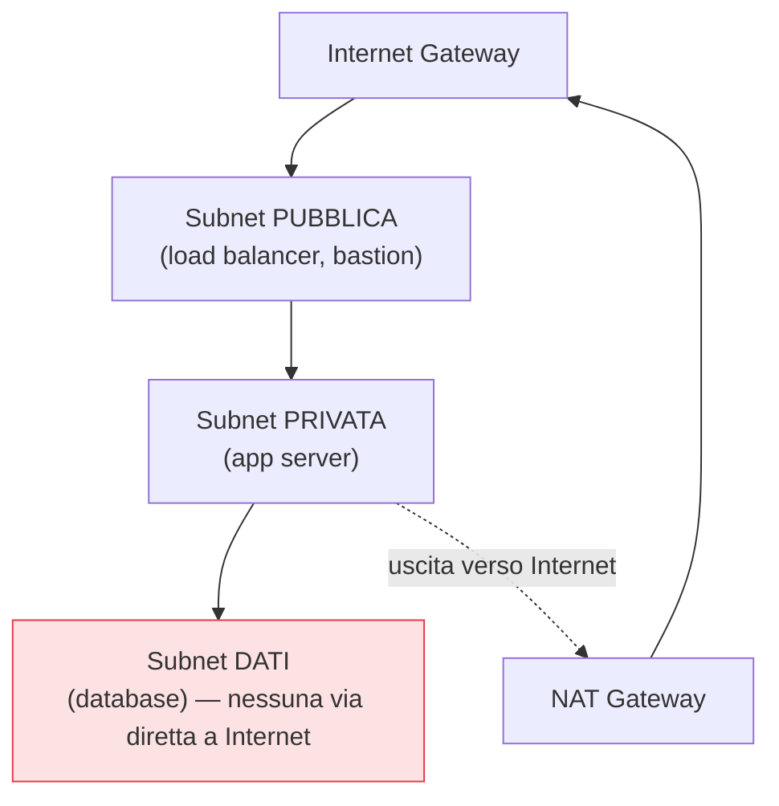

## Perché conta

Protette identità e dati, resta la rete — e nel cloud la rete non è un dato di fatto preesistente: la
**disegni tu**, da un foglio bianco. Una **rete virtuale privata (VPC)** è il tuo spazio di
indirizzamento isolato, in cui decidi quali porzioni (subnet) sono raggiungibili da Internet e quali
no, come scorre il traffico e cosa è permesso. Una rete disegnata male espone a Internet cose che
dovevano restare nascoste; una disegnata bene mette diversi strati tra l'attaccante e i dati.

## Subnet pubbliche e private



La distinzione fondamentale: una **subnet pubblica** ha una rotta diretta verso l'Internet gateway —
ci metti solo ciò che *deve* essere raggiungibile da fuori (un load balancer, al limite un bastion). Una
**subnet privata** non ha quella rotta: le sue risorse non sono raggiungibili da Internet. Se devono
*uscire* (per aggiornamenti, API esterne) lo fanno tramite un **NAT gateway**, che permette connessioni
in uscita ma non in entrata. I database stanno nel livello più interno, senza alcuna via verso
Internet.

## Il firewall distribuito: security group

Nel cloud il firewall non è una scatola al bordo della rete: è **distribuito**, attaccato a ogni
risorsa. I **security group** (NSG su Azure, firewall rules su GCP) sono insiemi di regole che dicono
quale traffico può entrare e uscire da una risorsa:

```text {hl_lines=[2,3]}
Security group del database:
  INBOUND: consenti 5432 (PostgreSQL) SOLO dal security group degli app server
  INBOUND: nient'altro
  → il database accetta connessioni solo dalle app, mai da Internet né da altro
```

La pratica potente è **referenziare altri security group invece di indirizzi IP**: "accetta dal
security group degli app server" resta corretto anche se gli IP cambiano e scala automaticamente. Di
default i security group **negano tutto l'inbound**: apri solo ciò che serve, verso le sorgenti
giuste.

## NACL: il secondo livello

Oltre ai security group (che sono *stateful* e stanno sulla risorsa), le **network ACL** operano al
livello della subnet, sono *stateless* e valutano il traffico in ingresso/uscita della sottorete
intera. Sono più grezze ma utili come secondo strato: per esempio bloccare interi range di indirizzi a
livello di subnet, sotto i security group più fini.


<details>
<summary><strong>Domanda:</strong> con identità forte e dati cifrati, la segmentazione di rete non è un residuo del vecchio mondo perimetrale? Se l'IAM decide chi accede, le subnet private servono ancora?</summary>
<p>Servono, perché identità e rete difendono da fallimenti diversi e si rinforzano a vicenda — è
esattamente la difesa in profondità. L'IAM protegge l'accesso <em>autenticato e autorizzato</em> alle API
del cloud; la rete protegge la <em>raggiungibilità</em> stessa dei servizi, che è un piano diverso.
Pensa a un database: l'IAM (o le sue credenziali) controlla chi può autenticarsi; ma se il database è in
una subnet privata senza rotta verso Internet, un attaccante che ha rubato le credenziali <em>non può
nemmeno raggiungerlo</em> da fuori — deve prima entrare nella rete, un ostacolo in più. Viceversa, se il
database fosse esposto a Internet, basterebbe una falla nell'autenticazione, una password debole, un
exploit del protocollo, per comprometterlo, e l'IAM non c'entrerebbe nulla. La rete riduce la
<em>superficie d'attacco</em>: ciò che non è raggiungibile non può essere attaccato, punto, qualunque sia
lo stato dell'autenticazione. Inoltre molte minacce non passano per l'IAM del cloud: vulnerabilità nei
servizi in ascolto, movimenti laterali dopo una compromissione iniziale, scansioni di massa. La
segmentazione limita il movimento laterale — compromesso un server, l'attaccante trova muri invece di
una rete piatta. Il "nuovo mondo" non abolisce la rete: la fonde con l'identità nel modello Zero Trust,
dove <em>entrambe</em> devono concedere l'accesso. L'errore del vecchio mondo era fidarsi della sola
rete; l'errore opposto, fidarsi della sola identità, è altrettanto fragile. La risposta giusta è:
tutti e due.</p>
</details>


## Conclusione

Nel cloud la rete la disegni tu: subnet pubbliche per ciò che deve stare in Internet, private per il
resto, database nel livello più interno, e un firewall distribuito — i security group — che di default
nega tutto e apre solo il necessario, referenziando altri gruppi invece degli IP. Disegnata la rete
interna, resta il punto più delicato: cosa esporre verso l'esterno e come. È il prossimo capitolo,
[esposizione e perimetro]().
