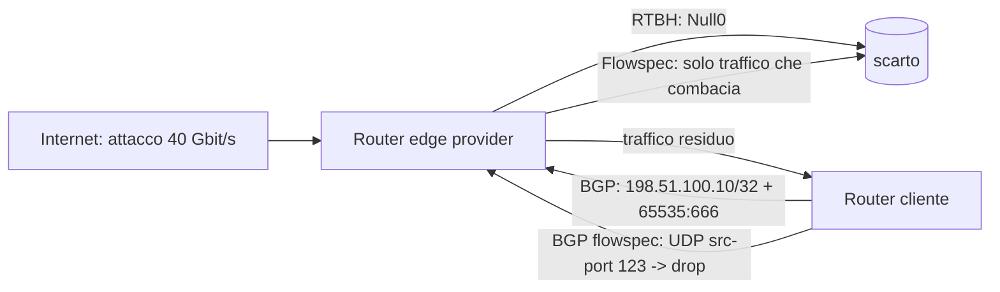

## Perché conta

Nell'[anatomia di un DDoS]() abbiamo visto che un attacco
volumetrico non si ferma sul bersaglio: quando il traffico malevolo supera la capacità del link, il pacchetto
buono e quello cattivo vengono scartati con la stessa probabilità, e nessun firewall in casa può rimediare,
perché il collo di bottiglia è *prima* del firewall. Se l'uplink è da $C = 10\,\text{Gbit/s}$ e arrivano
$A = 40\,\text{Gbit/s}$ di attacco, la frazione di traffico legittimo che sopravvive è circa

$$f \approx \frac{C}{A + L} = \frac{10}{40 + L} \lesssim 25\%$$

dove $L$ è il traffico legittimo. La soluzione è spostare il filtraggio a monte, sul router del provider o
dell'IXP, dove la capacità è sufficiente. BGP, il protocollo che già dice a quei router dove mandare i pacchetti,
può anche dire loro cosa buttare via. Due strumenti: **RTBH** (grossolano ma universale) e **Flowspec** (chirurgico).

## Come funziona

**RTBH (Remote Triggered Black Hole).** Il cliente annuncia al provider il prefisso sotto attacco (di solito
un `/32` o `/128`) marcato con la community `BLACKHOLE` (`65535:666`, RFC 7999). Il provider
installa una route verso un next-hop di scarto (`Null0`), quindi *tutto* il traffico verso quell'indirizzo
sparisce ai bordi della sua rete. Il costo è chiaro: la vittima diventa irraggiungibile, ma il resto
dell'infrastruttura sopravvive. Il blackholing può anche essere applicato per sorgente, con le
regole di [uRPF]() (RFC 5635).

**Flowspec.** Con la famiglia di indirizzi BGP *flow-spec* (RFC 8955) si annunciano regole di match
(destinazione, sorgente, protocollo, porte, lunghezza, flag TCP) e azioni (scarta, rate-limit, redirect).
Si può quindi scartare solo UDP da porta sorgente 123 verso il `/32` sotto attacco e lasciare vivo il resto.



## L'attacco (e i suoi effetti collaterali)

Il rischio non è un exploit ma l'uso improprio del meccanismo, e va modellato come in
[threat modeling]():

- **Il blackhole completa il lavoro dell'attaccante.** Con RTBH sul `/32` l'obiettivo è offline: il DDoS ha
  raggiunto il suo scopo, anche se la rete è salva. Per questo conviene mitigare con Flowspec o scrubbing
  quando possibile.
- **Annunci non autorizzati.** Se il provider accetta una community di blackhole da chiunque, un cliente
  (o un sessione BGP compromessa) può far sparire prefissi altrui. Per questo i prefissi accettati
  devono essere validati contro l'IRR e [RPKI]().
- **Prefissi troppo larghi.** Un `/24` marcato `BLACKHOLE` invece di un `/32` toglie dalla rete mille host.

Si verifica da un router cliente che l'annuncio sia partito e che il vicino lo abbia accettato:

```bash
vtysh -c "show ip bgp 198.51.100.10/32"
vtysh -c "show bgp neighbors 192.0.2.1 advertised-routes"
```

## La difesa

Lato cliente, con FRRouting, si prepara in anticipo una route-map che marca il `/32` e un next-hop di scarto,
così durante l'attacco basta un comando:

```text {hl_lines=[2,3,8,9]}
! 1. route statica di scarto, marcata e annunciata
ip route 198.51.100.10/32 Null0 tag 666
route-map RTBH permit 10
 match tag 666
 set community 65535:666 no-export
 set local-preference 200
!
router bgp 64500
 neighbor 192.0.2.1 remote-as 64496
 address-family ipv4 unicast
  redistribute static route-map RTBH
  neighbor 192.0.2.1 prefix-list RTBH-OUT out
 exit-address-family
!
ip prefix-list RTBH-OUT permit 198.51.100.0/24 ge 32
```

La prefix-list `ge 32` garantisce che escano solo `/32` interni al proprio blocco, mai route più larghe.
Lato provider (o su un proprio edge con BIRD) si accetta la community solo da sessioni fidate e solo per
prefissi del cliente:

```text {hl_lines=[3,4,5]}
filter from_customer {
    if net ~ [198.51.100.0/24{32,32}] && (65535, 666) ~ bgp_community then {
        bgp_next_hop = 192.0.2.254;   # indirizzo discard
        bgp_local_pref = 200;
        accept;
    }
    reject;
}
```

Per i flussi che si possono descrivere con precisione, FRRouting supporta Flowspec con `address-family ipv4 flowspec`
e `neighbor X activate`; i router edge del provider devono poi tradurre le regole in ACL hardware, quindi
conviene fissare limiti sul numero di regole accettate (`maximum-prefix`). Il provider dovrebbe rifiutare
regole che non riguardano indirizzi del cliente (la validazione di RFC 8955 §6). Il tutto va affiancato
da [filtri anti-spoofing]() e da [CoPP]()
per proteggere i router stessi.

## Lab

Con tre router FRR in containerlab (cliente `AS64500`, provider `AS64496`, un "Internet" che genera traffico),
vedi la [roadmap]():

1. Dal nodo Internet lancia `ping -f 198.51.100.10` verso un host del cliente e osserva il traffico su `eth1` del cliente.
2. Sul cliente aggiungi `ip route 198.51.100.10/32 Null0 tag 666` con la route-map sopra. Cosa vedi su `show ip route 198.51.100.10` del provider?
3. Prova ad annunciare con la community anche `198.51.100.0/24`: cosa deve fare il filtro del provider e perché?


<details><summary>Soluzione</summary>
<ol>
<li>Il traffico arriva sul link del cliente a pieno ritmo: è la condizione che il blackhole deve evitare.</li>
<li>Il provider ha una route per il <code>/32</code> con next-hop <code>192.0.2.254</code> (discard) e community <code>65535:666</code>: il ping non esce più dal suo edge e il contatore su <code>eth1</code> del cliente si ferma.</li>
<li>Il filtro lo rifiuta: l'espressione <code>{32,32}</code> accetta solo <code>/32</code>. Se passasse, tutti gli host del <code>/24</code> sarebbero irraggiungibili per un errore di annuncio.</li>
</ol>
</details>


## Conclusione

RTBH e Flowspec spostano la difesa dal bersaglio al punto in cui c'è abbastanza banda per assorbire l'attacco.
Il blackhole è semplice e quasi universale, ma sacrifica la vittima; Flowspec è preciso ma richiede fiducia e limiti
stretti sul provider. In entrambi i casi la sicurezza dell'annuncio (prefix-list, RPKI, `maximum-prefix`) conta
quanto la mitigazione.

**Prossimo nella serie:** [Torna alla roadmap]()
