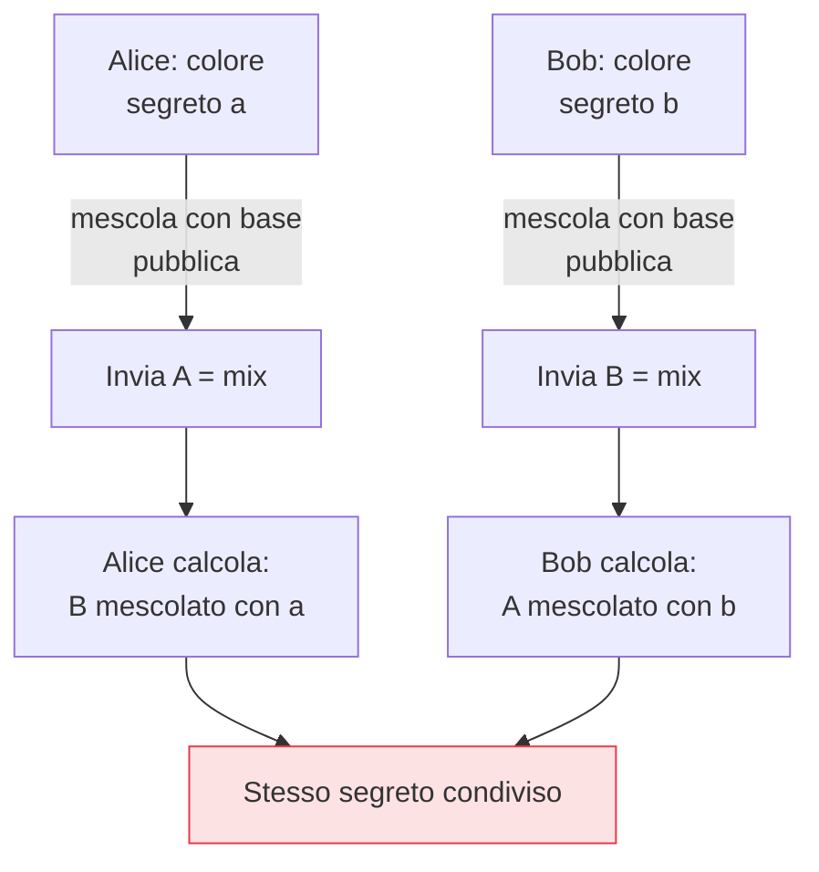

## Perché conta

La [crittografia asimmetrica]() può consegnare una
chiave di sessione cifrandola con la chiave pubblica del destinatario. Funziona, ma ha un difetto
grave: se un giorno la chiave privata trapela, un attaccante che aveva *registrato* tutto il traffico
passato può ora decifrarlo *tutto*, retroattivamente. Lo scambio di chiavi **Diffie-Hellman** offre un
modo migliore di concordare un segreto — e, nella sua forma effimera, elimina proprio questo rischio.

## Diffie-Hellman: un segreto che non viaggia mai

L'idea è contro-intuitiva: due parti concordano un segreto condiviso *parlando su un canale pubblico*,
senza mai trasmettere il segreto. La metafora dei colori:



Ciascuno combina il proprio segreto con il valore pubblico ricevuto dall'altro e arriva allo *stesso*
risultato. Un osservatore vede i valori pubblici scambiati ma non riesce a ricostruire il segreto: è
il problema del logaritmo discreto a proteggerlo. In forma matematica, con base $g$ e modulo primo
$p$:

$$ (g^a \bmod p)^b \equiv (g^b \bmod p)^a \equiv g^{ab} \bmod p $$

Alice e Bob calcolano lo stesso $g^{ab}$; l'osservatore ha solo $g^a$ e $g^b$ e non può derivarlo. La
versione su curve ellittiche, **ECDH** (con Curve25519), fa lo stesso con chiavi corte e veloci ed è
quella usata oggi.

## Il vero premio: forward secrecy

Qui sta il salto. Se le chiavi $a$ e $b$ sono **effimere** — generate nuove per ogni sessione e
buttate subito dopo — si ottiene la **forward secrecy** (o perfect forward secrecy):

```text {hl_lines=[3]}
Chiave di consegna statica (RSA): registro il traffico oggi, rubo la chiave fra 2 anni → decifro TUTTO
Diffie-Hellman EFFIMERO (ECDHE):  ogni sessione ha un segreto nuovo, già distrutto
  → rubare la chiave di oggi NON decifra le sessioni passate: i loro segreti non esistono più
```

La forward secrecy spezza il legame tra la compromissione futura e le conversazioni passate. È il
motivo per cui il [TLS]() moderno (1.3) usa *solo* scambi
effimeri (ECDHE): registrare traffico cifrato oggi nella speranza di decifrarlo domani —
l'attacco "harvest now, decrypt later" — diventa inutile contro le chiavi già distrutte.

## DH autentica? No — e serve saperlo

Diffie-Hellman concorda un segreto, ma **non autentica** chi c'è dall'altra parte. Da solo è
vulnerabile al man-in-the-middle: un attaccante nel mezzo fa uno scambio DH con ciascuna parte e le
collega. Per questo DH va *combinato* con l'autenticazione — le [firme digitali]()
del prossimo capitolo, che in TLS provano l'identità del server mentre ECDHE stabilisce il segreto.
Scambio di chiavi e autenticazione sono due compiti distinti, e servono entrambi.


<details>
<summary><strong>Domanda:</strong> se la forward secrecy è così importante, perché è esistito a lungo (e in parte esiste ancora) il modello con chiave statica senza di essa? Dov'è il compromesso?</summary>
<p>Il modello a chiave statica non è sopravvissuto per stupidità, ma per una serie di compromessi concreti
che all'epoca pesavano e in parte pesano ancora — ed è utile capirli per vedere perché il vento è
definitivamente cambiato. Primo, il costo computazionale: generare una nuova coppia di chiavi effimere a
<em>ogni</em> handshake costa CPU, e quando i server erano meno potenti e il traffico HTTPS cresceva, la
tentazione di riusare una chiave statica (nessuna generazione per sessione, possibilità di cifrare la
chiave di sessione con RSA una volta) era un risparmio reale. Con l'accelerazione hardware e con ECDHE su
Curve25519 — velocissimo — questo costo oggi è trascurabile, e l'argomento è caduto. Secondo, e meno
ovvio, la <em>visibilità</em>: in molte reti aziendali e data center si erano costruiti strumenti di
sicurezza e debugging che decifravano passivamente il traffico TLS possedendo la chiave privata del
server — ispezione, IDS, troubleshooting. La forward secrecy rompe deliberatamente questa capacità:
proprio perché nessuna chiave statica decifra le sessioni, quegli strumenti passivi smettono di
funzionare, e questo ha generato resistenza da parte di chi ci faceva affidamento. La risposta corretta è
stata spostare quelle funzioni a un modello diverso (terminazione TLS esplicita su un proxy che partecipa
all'handshake, non intercettazione passiva), ma la transizione ha avuto attrito. Terzo, la complessità
dello stato: le chiavi effimere vanno generate con buona entropia e gestite correttamente per sessione, e
un'implementazione sciatta può introdurre bug. Detto tutto questo, il compromesso oggi è nettamente a
favore della forward secrecy, e non per moda: la minaccia "harvest now, decrypt later" è diventata
concreta — avversari con risorse registrano oggi traffico cifrato scommettendo di poterlo decifrare
domani, per furto di chiave o per i computer quantistici futuri. Contro questa minaccia la chiave statica
è un disastro (un furto futuro apre tutto il passato), mentre l'effimero la neutralizza alla radice. Per
questo TLS 1.3 ha <em>eliminato</em> gli scambi senza forward secrecy, non li ha solo sconsigliati: il
piccolo costo residuo non giustifica più l'enorme rischio retroattivo. Il compromesso esisteva, ma gli
sviluppi — hardware veloce, curve efficienti, minacce di lungo periodo — l'hanno risolto in un'unica
direzione.</p>
</details>


## Conclusione

Diffie-Hellman fa concordare un segreto su un canale pubblico senza mai trasmetterlo, ed ECDHE
(effimero, su Curve25519) aggiunge la forward secrecy: compromettere una chiave futura non apre le
sessioni passate. Ma DH non autentica: va combinato con un meccanismo che provi *chi* c'è dall'altra
parte — firmando con la chiave privata ciò che chiunque può verificare con quella pubblica. Sono le
firme digitali, prossimo capitolo.
