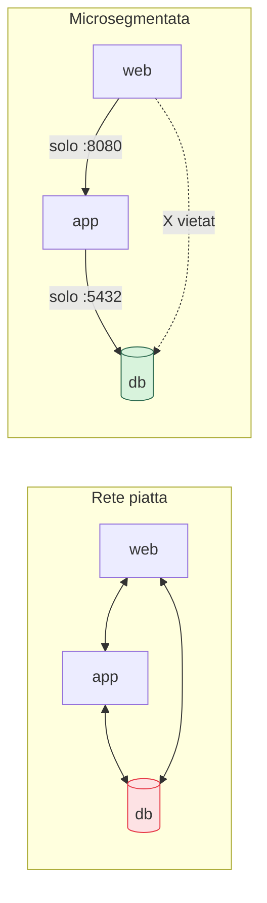

## Perché conta

Ridotta l'[esposizione esterna](), resta il pericolo
interno: cosa succede *dopo* che un attaccante entra? In una **rete piatta**, dove tutto può parlare con
tutto, la risposta è "raggiunge ovunque". Compromesso un singolo server web, si muove lateralmente fino
al database, ai backup, ai sistemi di gestione. La **segmentazione** spezza questa libertà di movimento;
il **Zero Trust** la spinge fino in fondo, eliminando l'idea stessa che "dentro la rete" significhi
"fidato".

## Dal perimetro alla microsegmentazione



La **microsegmentazione** definisce, per ogni servizio, *esattamente* con chi può comunicare e su quali
porte — in pratica applicando il [privilegio minimo]()
alla rete. Il web server parla con l'app, l'app col database, e nient'altro: il web server non può
raggiungere il database direttamente. Compromesso il web, l'attaccante trova muri, non una strada
aperta.

## I tre pilastri del Zero Trust

```text {hl_lines=[1,2,3]}
1. Verifica esplicita   → ogni richiesta autenticata e autorizzata, sempre
2. Privilegio minimo    → accesso solo a ciò che serve, per il tempo che serve
3. Assumi la breach     → progetta come se l'attaccante fosse già dentro
```

Il terzo punto è il cambio di mentalità: non "teniamo fuori i cattivi", ma "diamo per scontato che
qualcuno entrerà, e limitiamo cosa potrà fare". Ne consegue che il traffico *interno* va trattato con
lo stesso sospetto di quello esterno: autenticato, cifrato, autorizzato richiesta per richiesta.

## Identità dei servizi e mTLS

Nel Zero Trust cloud-native, anche i servizi tra loro si **autenticano con un'identità**, non si fidano
per indirizzo IP. Lo strumento è il **mTLS (mutual TLS)**: entrambe le parti di una connessione
presentano un certificato e si verificano a vicenda, così il traffico è insieme cifrato e autenticato.
Le **service mesh** automatizzano questo per i microservizi, emettendo e ruotando i certificati e
applicando policy del tipo "il servizio A può chiamare il servizio B, non C" — microsegmentazione a
livello di identità del servizio, non più solo di rete.


<details>
<summary><strong>Domanda:</strong> microsegmentare ogni servizio, dare identità a tutto, mTLS ovunque: non è un livello di paranoia che ha senso solo per banche e governi? Per un'app normale non è spreco?</summary>
<p>Lo sembrava dieci anni fa, quando richiedeva mesi di lavoro manuale; oggi è in gran parte
automatizzato e il calcolo rischio/costo è cambiato per tutti, non solo per banche e governi. Il motivo
di fondo è che il <em>movimento laterale</em> è la fase in cui un intrusione diventa un disastro: la
compromissione iniziale — una vulnerabilità in un web server, una credenziale rubata — è spesso
inevitabile e limitata; è ciò che l'attaccante riesce a raggiungere <em>dopo</em> a determinare se perdi
un server o l'intera base dati. Una rete piatta trasforma ogni piccola breccia in accesso totale; la
segmentazione la contiene. Non serve essere una banca per avere dati che non vuoi perdere: basta avere
dati di clienti, segreti, backup. Sul "livello di paranoia": non devi fare tutto e subito. La
microsegmentazione di base — separare i tier (web/app/dati) con i security group, impedire al web di
raggiungere il database direttamente — costa pochissimo e blocca il percorso laterale più comune; è il
minimo sindacale, non paranoia. L'mTLS e le service mesh hanno senso quando hai molti microservizi, e
lì te li dà la piattaforma quasi gratis (una mesh gestita li configura per te). Il principio "assumi la
breach" non è pessimismo da iper-sicurezza: è realismo, perché le brecce avvengono, e l'unica domanda è
se la tua architettura le amplifica o le contiene. Fai il livello proporzionato al valore dei tuoi dati:
per quasi tutti, è più di quanto facciano oggi, e meno di quanto temano.</p>
</details>


## Conclusione

La segmentazione spezza la libertà di movimento dell'attaccante, e il Zero Trust elimina la fiducia
basata sulla posizione di rete: verifica esplicita, privilegio minimo, "assumi la breach", fino
all'identità dei servizi e all'mTLS. Tutto questo presuppone però di *vedere* cosa accade nel tuo
ambiente: senza visibilità, non sai né di essere stato compromesso né come reagire. È il tema dei
prossimi capitoli, a partire da [logging e audit trail]().
