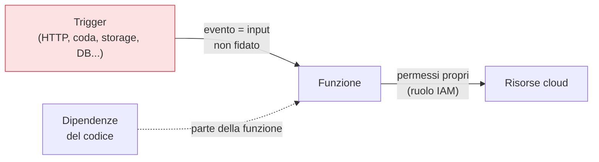

## Perché conta

Il serverless (AWS Lambda, Azure Functions, Cloud Functions) porta l'astrazione all'estremo: non
gestisci server, non applichi patch al sistema operativo, non dimensioni capacità. Questo **elimina**
davvero alcune classi di rischio — niente OS da tenere aggiornato, niente server esposti da indurire. Ma
la sicurezza non svanisce: si **sposta**. La superficie d'attacco si concentra su ciò che resta tuo —
il codice, le sue dipendenze, i permessi di ogni funzione, e i dati che entrano dai trigger.

## Dove si sposta il rischio



Tre punti caldi:

- **L'evento è input non fidato.** Una funzione è invocata da *trigger* — una richiesta HTTP, un
  messaggio in coda, un file caricato, un record di database. Ogni evento è un input esterno da
  validare: l'injection non sparisce col serverless, cambia solo porta d'ingresso.
- **Ogni funzione ha i suoi permessi.** Con tante piccole funzioni, è facile dare a tutte un ruolo
  largo "per comodità". È l'opposto di ciò che serve: il [privilegio
  minimo]() va applicato **per funzione**, così che
  una funzione compromessa possa toccare solo le sue risorse.
- **Le dipendenze sono codice tuo.** Una funzione è il tuo codice più le librerie che importa: una
  dipendenza vulnerabile è una vulnerabilità della funzione. Vanno scansionate come qualsiasi altro
  software.

## Il privilegio minimo, moltiplicato

```text {hl_lines=[2,3]}
Antipattern serverless comune:
  un solo ruolo "FunctionRole" con permessi larghi, condiviso da 50 funzioni
  → compromessa UNA funzione, l'attaccante ha i permessi di TUTTE
Pattern corretto:
  un ruolo per funzione, con SOLO i permessi di quella funzione
  → il raggio d'esplosione resta confinato a quella singola funzione
```

Il serverless moltiplica il numero di identità (una per funzione): è un'occasione per un privilegio
minimo granulare, o una trappola se si cede alla comodità del ruolo unico. La granularità qui non è un
lusso: è ciò che impedisce che una funzione marginale diventi la chiave di tutto.

## Effimero non vuol dire invulnerabile

Un mito del serverless: "le funzioni durano pochi secondi, quindi non c'è persistenza da attaccare". È
vero che l'ambiente è effimero, ma l'attaccante non ha bisogno di persistere *nella funzione*: gli basta
usarne i **permessi** nei secondi d'esecuzione per leggere dati, chiamare altre risorse, esfiltrare. E
spesso gli ambienti vengono *riusati* tra invocazioni, lasciando in memoria segreti o dati della
richiesta precedente. L'effimerità riduce la persistenza, non l'impatto.


<details>
<summary><strong>Domanda:</strong> il serverless toglie OS, patch e server da gestire, cioè gran parte di ciò di cui parla questa serie. Non è di per sé molto più sicuro, al punto che preoccuparsene tanto è controproducente?</summary>
<p>È più sicuro su alcuni assi e identico o più insidioso su altri, e trattarlo come "sicuro per
costruzione" è precisamente l'errore che porta agli incidenti serverless reali. Cosa guadagni davvero,
ed è tanto: niente sistema operativo da patchare (sparisce un'enorme fonte di vulnerabilità), niente
server esposti da indurire, niente capacità da proteggere da esaurimento, e un isolamento degli ambienti
d'esecuzione gestito dal provider. Questo elimina classi intere di attacchi, ed è un vantaggio reale.
Ma ciò che resta è proprio il cuore di questa serie, non la sua periferia: <em>identità e permessi</em>
(ogni funzione è un principal con un ruolo — e il privilegio minimo per funzione è più critico che mai,
perché le funzioni sono tante), <em>validazione degli input</em> (ogni trigger è una porta d'ingresso per
dati non fidati, e l'injection vive benissimo nel serverless), <em>dipendenze</em> (il tuo codice più le
librerie, scansionabili come qualsiasi software), <em>segreti</em> e <em>dati</em> (gestiti come ovunque).
In più il serverless introduce rischi <em>propri</em>: la proliferazione di funzioni con permessi che
nessuno rivede, i trigger che collegano servizi in catene difficili da seguire, il riuso degli ambienti.
La sensazione di "più sicuro quindi me ne preoccupo meno" è esattamente ciò che fa dare a tutte le
funzioni lo stesso ruolo largo e fa saltare la validazione degli input "tanto è solo una funzioncina".
Il serverless sposta il lavoro di sicurezza dall'infrastruttura al codice e ai permessi: è meno lavoro in
totale, ma concentrato dove un errore si paga caro. Approfittane per fare bene ciò che resta, non per
smettere di guardarlo.</p>
</details>


## Conclusione

Il serverless elimina OS e server, ma sposta il rischio su codice, dipendenze, validazione degli input
dei trigger e permessi — con il privilegio minimo *per funzione* come difesa centrale. Finora abbiamo
guardato i singoli servizi; sopra tutti c'è il modo in cui organizzi gli account, che decide gli argini
dell'intero ambiente. È il prossimo capitolo, [multi-account e landing
zone]().
