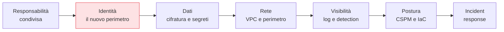

## Perché questa serie

Il cloud non è "il computer di qualcun altro": è un modello operativo diverso, con primitive di
sicurezza diverse. Firewall, identità, chiavi, log e perimetro esistono ancora, ma cambiano forma —
e la maggior parte degli incidenti cloud non nasce da exploit sofisticati, bensì da **configurazioni
sbagliate**: un bucket pubblico, un ruolo troppo permissivo, una chiave lasciata in chiaro, un log mai
attivato. Questa serie costruisce, capitolo dopo capitolo, il modello mentale per non commettere quegli
errori — e per riconoscerli quando li erediti.

L'approccio è **provider-agnostico**: i principi valgono su AWS, Azure e GCP, e dove serve cito il
servizio concreto di ciascuno. Non è un tutorial "clicca qui": è il *perché* dietro ogni controllo,
così che tu sappia adattarlo al tuo ambiente.

## Come leggerla

I capitoli sono ordinati come un percorso: ciascuno poggia sui precedenti. Si parte dal modello di
responsabilità condivisa (chi protegge cosa), poi l'identità — il vero perimetro del cloud — poi dati,
rete, visibilità, postura e automazione, fino alla risposta agli incidenti.

## I capitoli

1. [Il modello di responsabilità condivisa]()
2. [IAM: identità e accessi]()
3. [Il principio del privilegio minimo]()
4. [L'identità dei workload]()
5. [Gestione dei segreti e KMS]()
6. [Crittografia dei dati nel cloud]()
7. [Sicurezza dello storage a oggetti]()
8. [La rete virtuale: VPC e subnet]()
9. [Esposizione e perimetro]()
10. [Segmentazione e Zero Trust nel cloud]()
11. [Logging e audit trail]()
12. [Threat detection nel cloud]()
13. [CSPM: la postura di sicurezza]()
14. [Infrastructure as Code sicuro e policy as code]()
15. [Sicurezza di Kubernetes gestito]()
16. [Serverless security]()
17. [Multi-account e landing zone]()
18. [Compliance e governance nel cloud]()
19. [Incident response nel cloud]()

## Il filo conduttore

Un filo solo attraversa tutta la serie: nel cloud **l'identità è il perimetro**, e la
**configurazione è il campo di battaglia**. Chi capisce questi due fatti ha già evitato la maggior
parte degli incidenti reali. Si parte dal primo capitolo: chi è responsabile di cosa.
