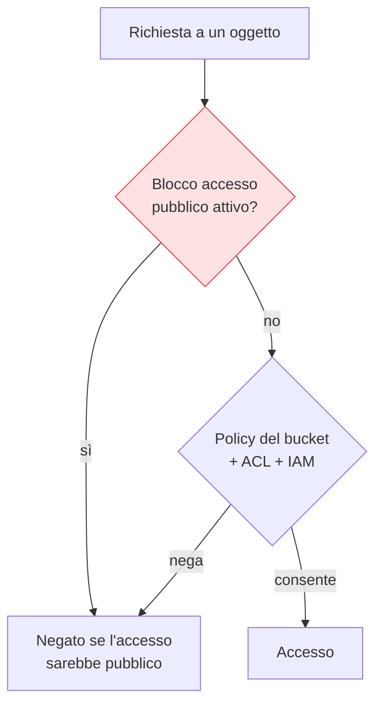

## Perché conta

Se c'è un'immagine simbolo degli incidenti cloud, è il **bucket pubblico per sbaglio**: milioni di
record di clienti, backup di database, documenti interni, tutti raggiungibili da chiunque conosca (o
indovini) l'URL. Lo storage a oggetti è il servizio cloud più usato e più semplice — e proprio la sua
semplicità lo rende facile da esporre. Un singolo flag sbagliato, una policy copiata male, e dati
privati diventano pubblici senza alcun avviso.

## Il controllo d'accesso a strati



L'accesso a un oggetto è deciso dalla combinazione di più livelli: le **policy IAM** del richiedente,
le **policy del bucket**, le vecchie **ACL** per-oggetto, e — sopra tutto — il **blocco dell'accesso
pubblico**. Quest'ultimo è un interruttore a monte che *impedisce* qualsiasi configurazione di rendere
pubblico il bucket, anche se una policy o un'ACL provasse a farlo. Va attivato **a livello di account**,
così nessun nuovo bucket possa sfuggire.

## Le regole che evitano il 95% dei disastri

```text {hl_lines=[1,2]}
1. Blocco accesso pubblico ATTIVO a livello di account (default per tutto)
2. Niente ACL: disabilitale, usa solo policy (più chiare e verificabili)
3. Cifratura a riposo forzata (anche via policy che rifiuta upload non cifrati)
4. Versionamento + MFA delete sui bucket critici (anti-ransomware, anti-errore)
5. Accesso solo via endpoint privati dove possibile, non via Internet
```

Il punto 1 da solo elimina quasi tutti i breach da bucket pubblico. Il punto 4 protegge da
cancellazioni accidentali e da ransomware che cifra o elimina i dati: con il versionamento, le versioni
precedenti restano recuperabili.

## Accessi temporanei invece di permessi pubblici

Spesso un bucket viene reso pubblico "perché serve condividere un file". Non serve: esistono le **URL
firmate (presigned URL)**, link temporanei che concedono accesso a *un* oggetto per *un tempo limitato*,
senza aprire nulla al mondo. È il modo corretto di far scaricare un file a un utente esterno senza
esporre il bucket.


<details>
<summary><strong>Domanda:</strong> i provider ormai fanno i bucket privati di default e avvisano se qualcosa è pubblico. Il problema del bucket pubblico non è ormai risolto, rendendo superflue tutte queste precauzioni?</summary>
<p>È molto meno frequente di prima, ma "risolto" è un'illusione pericolosa, perché i default proteggono
solo lo scenario più ovvio e lasciano scoperti tutti gli altri che causano i breach di oggi. Il private
di default protegge il bucket <em>nuovo creato senza pensarci</em> — ma non protegge dai casi reali:
qualcuno che <em>deliberatamente</em> rende pubblico un bucket "per far funzionare una cosa" e poi
dimentica; una policy del bucket scritta larga che concede accesso a "tutti gli utenti autenticati del
cloud" (che non significa i tuoi utenti, significa <em>chiunque</em> abbia un account su quel cloud —
un classico frainteso); un accesso cross-account configurato male; dati sensibili messi in un bucket
pensato per contenuti pubblici; o il blocco accesso pubblico disattivato a livello di account da chi
voleva pubblicare un sito statico e ha abbassato la guardia per tutti. Inoltre gli avvisi del provider
dipendono dal fatto che qualcuno li legga e li capisca: in un'organizzazione con centinaia di bucket,
l'avviso si perde nel rumore. Le precauzioni che restano indispensabili sono proprio quelle che i default
non coprono: il blocco a livello di <em>account</em> (così nessuno possa rendere pubblico un singolo
bucket nemmeno volendo, senza un'azione esplicita e tracciata), la disabilitazione delle ACL, le policy
scritte strette e verificate con gli strumenti di analisi, e le URL firmate al posto dell'accesso
pubblico quando serve condividere. Il default è il pavimento, non il soffitto: alza il soffitto tu.</p>
</details>


## Conclusione

Lo storage a oggetti è potente e insidioso: il blocco dell'accesso pubblico a livello di account,
l'abbandono delle ACL, la cifratura forzata, il versionamento e le URL firmate eliminano quasi tutti i
disastri. Finora abbiamo protetto identità e dati; ora il discorso si sposta sulla rete, che nel cloud
si disegna da zero. È il prossimo capitolo, [la rete virtuale: VPC e
subnet]().
