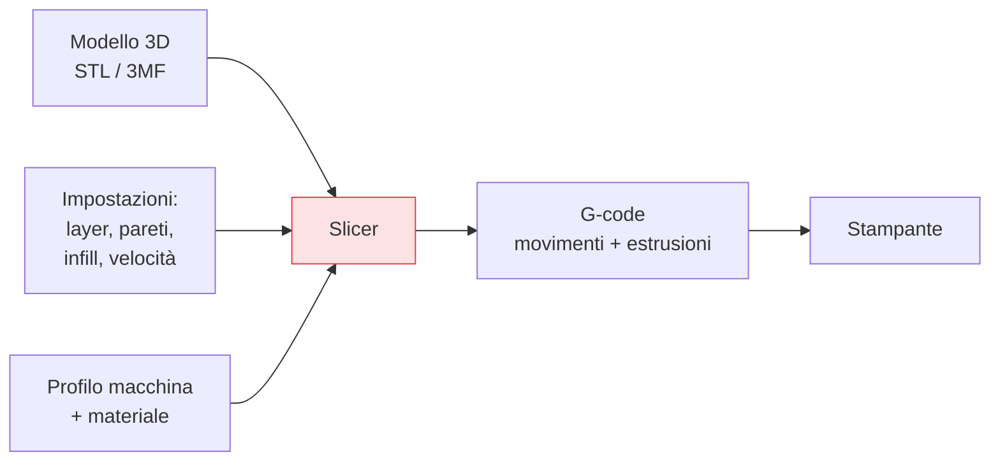

## Perché conta

Un modello 3D (un file STL o 3MF) descrive una *forma*, ma la [stampante]()
non sa cosa farne: sa solo eseguire movimenti ed estrusioni. Il **slicer** è il programma che colma il
divario, "affettando" (slicing) il modello in strati e generando il **G-code**: la lista di istruzioni
che la macchina esegue. Le impostazioni dello slicer decidono qualità, resistenza e tempo più di
qualsiasi altra cosa dopo la calibrazione.

## Cosa fa lo slicer



Lo slicer prende il modello, il profilo della tua macchina e del materiale, e le tue impostazioni, e
calcola *ogni* movimento: dove deporre plastica, quanta, a che velocità e temperatura. Il risultato è
il G-code, specifico per quella stampa e quella stampante.

## Il G-code, in breve

Non devi scriverlo, ma capirlo aiuta a diagnosticare. È testo, una riga per comando:

```gcode {hl_lines=[2,4]}
G28              ; home: porta gli assi a zero
M104 S210        ; imposta il nozzle a 210°C
G1 X50 Y50 Z0.2 F3000  ; muoviti in questo punto a questa velocità
G1 X80 E5        ; muoviti estrudendo 5mm di filamento (E = estrusore)
M106 S255        ; ventola al 100%
```

Ogni riga è un'istruzione elementare: muoviti, estrudi, scalda, accendi la ventola. Una stampa sono
decine di migliaia di queste righe. Quando qualcosa va storto, poter leggere il G-code (o la sua
anteprima nello slicer) rivela cosa la macchina *crede* di dover fare.

## Le impostazioni che contano

Poche scelte determinano la gran parte del risultato:

- **Altezza layer**: lo spessore di ogni strato (es. 0,2 mm). Più sottile = più dettaglio e superfici
  lisce, ma molto più tempo. Più spesso = veloce e robusto, ma "a scalini" visibili.
- **Perimetri (pareti)**: quanti contorni ha il guscio esterno. Sono il fattore principale di
  **resistenza** del pezzo — più dei riempimenti. 3 perimetri danno un pezzo molto più solido di 2.
- **Riempimento (infill)**: la struttura interna, in percentuale e geometria (gyroid, griglia).
  Il 15-20% basta per quasi tutto; serve più solo per pezzi molto caricati.
- **Velocità**: più lento = più qualità e adesione, più veloce = più difetti. Il compromesso
  centrale di ogni stampa.
- **Supporti e adesione**: strutture temporanee per gli [sbalzi]()
  e aiuti per il [primo layer]().

## Il triangolo qualità-tempo-resistenza

```text {hl_lines=[2]}
Non puoi massimizzare tutto insieme:
  layer sottile + lento + molti perimetri  → bellissimo e robusto, ma LENTISSIMO
  layer spesso + veloce + pochi perimetri   → rapido, ma brutto e/o debole
→ scegli in base allo SCOPO del pezzo: un prototipo veloce ≠ un pezzo finale ≠ un oggetto decorativo
```

Non esiste un profilo "migliore": esiste quello giusto per *quel* pezzo. Un prototipo da buttare vuole
velocità; un oggetto in vista vuole layer sottili; un pezzo meccanico vuole perimetri. Imparare a
spostare questi cursori con intenzione è metà del mestiere.


<details>
<summary><strong>Domanda:</strong> per rendere un pezzo più resistente, la cosa più ovvia è alzare la percentuale di riempimento. Perché si dice invece di aumentare i perimetri?</summary>
<p>Perché l'intuizione "più pieno dentro = più forte" sovrastima enormemente il contributo dell'infill e
sottovaluta quello del guscio, e capire perché ti fa risparmiare tempo e filamento ottenendo pezzi più
robusti. Pensa a come si rompe o si flette un pezzo sotto carico: lo sforzo si concentra sulla
<em>superficie esterna</em>, non nel cuore. In una trave inflessa, le fibre più sollecitate sono quelle
più lontane dall'asse neutro, cioè le pareti; il materiale al centro contribuisce pochissimo alla
rigidità flessionale — è lo stesso principio per cui i profilati sono cavi (tubi, travi a I) e non pieni:
quasi tutta la resistenza sta nel perimetro. In un pezzo FDM i <em>perimetri</em> sono proprio quel
guscio portante, filamenti continui e densi che corrono lungo le pareti, mentre l'<em>infill</em> è una
struttura rada e discontinua pensata soprattutto a <em>sostenere i layer superiori</em> e a dare un po' di
rigidità al riempimento, non a reggere il carico principale. Questo si vede nei numeri: passare da 2 a 4
perimetri può aumentare la resistenza a flessione in modo molto più marcato che passare dal 20% all'80%
di infill, e il salto di infill costa pochissima resistenza aggiunta a fronte di <em>molto</em> più tempo
e filamento — oltre un certo punto riempire di più è quasi sprecato. C'è anche un effetto collaterale
pratico: infill altissimi generano molto calore interno e possono peggiorare la qualità e persino
indebolire per via dell'accumulo termico, mentre pareti abbondanti distribuiscono meglio. La regola
operativa che ne deriva: per un pezzo funzionale, aumenta prima i <em>perimetri</em> (3-4, o di più per
pareti sottili molto sollecitate) e tieni l'infill in una fascia moderata (15-30%); alza l'infill solo se
il pezzo ha grandi superfici piane che devono resistere a compressione o schiacciamento locale, o per
dare supporto a coperchi ampi. E non dimenticare la leva che vale più di entrambi per i carichi
direzionali: l'<em>orientamento</em> di stampa, perché anche il guscio più spesso cede se lo sforzo
sfoglia gli strati. In sintesi: la resistenza di un pezzo FDM vive nella sua pelle più che nelle sue
viscere; spendi il materiale sulle pareti, non nel centro.</p>
</details>


## Conclusione

Lo slicer traduce il modello in G-code, la lista di movimenti che la macchina esegue, e le sue
impostazioni — altezza layer, perimetri, infill, velocità — governano il triangolo
qualità-tempo-resistenza. Ma anche il G-code perfetto fallisce se il *primo strato* non aderisce al
piano: è il fondamento su cui si regge tutta la stampa, e la causa numero uno dei fallimenti. Il primo
layer e l'adesione, prossimo capitolo.
