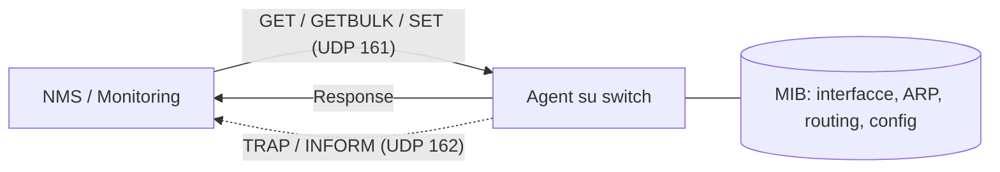

## Perché conta

Ogni switch, router, firewall, UPS e stampante parla SNMP. È il protocollo con cui il sistema di monitoring
legge contatori, tabelle di routing e ARP, e con cui, se l'accesso è in scrittura, cambia la configurazione.
È quindi il **management plane** per eccellenza: chi lo controlla vede la topologia e, spesso, può modificarla.
Eppure SNMPv1 e v2c autenticano con una *community string*: una parola, spesso `public` o `private`, inviata
in chiaro in UDP/161. Nessun utente, nessuna cifratura, nessuna protezione dai replay.

È il classico bersaglio del [threat modeling](): superficie
dimenticata, privilegi alti, credenziali deboli. Se hai già visto come si proteggono gli accessi di
[layer 2](), SNMP è la stessa lezione applicata al
piano di gestione.

## Come funziona

Un **manager** interroga un **agent** che espone un albero di oggetti, il MIB, indirizzati da OID
(es. `1.3.6.1.2.1.1.5.0` è `sysName`). Le operazioni principali sono GET, GETNEXT, GETBULK (v2c+), SET e le
notifiche TRAP/INFORM che l'agent invia verso UDP/162.



SNMPv3 (RFC 3411) separa il **security model** dall'access control. Lo **User-based Security Model** (RFC 3414)
definisce tre livelli:

| Livello | Autenticazione | Cifratura | Uso |
|---|---|---|---|
| `noAuthNoPriv` | solo username | no | da evitare |
| `authNoPriv` | HMAC | no | integrità senza riservatezza |
| `authPriv` | HMAC | AES (RFC 3826) | livello da usare |

La password dell'utente non viaggia mai: viene trasformata in una chiave $K_u$ e poi **localizzata** sull'engine
di destinazione, così che compromettere un agent non riveli le chiavi valide per gli altri:

$$K_{ul} = H\big(K_u \,\|\, \text{engineID} \,\|\, K_u\big)$$

Ogni messaggio porta `engineBoots` ed `engineTime`: l'agent scarta quelli fuori da una finestra di 150 secondi,
il che blocca i replay (e rende l'[orologio]() di nuovo una dipendenza).

## L'attacco

**Enumerazione.** Con una community indovinata si legge tutto. Nel lab (agent `10.10.0.2`):

```bash
# ricerca di community valide con una wordlist (UDP, veloce)
onesixtyone -c communities.txt 10.10.0.2

# dump dell'intero MIB-2 e delle tabelle interessanti
snmpwalk -v2c -c public 10.10.0.2 1.3.6.1.2.1
snmpwalk -v2c -c public 10.10.0.2 1.3.6.1.2.1.4.22     # tabella ARP
snmpwalk -v2c -c public 10.10.0.2 1.3.6.1.2.1.4.21     # tabella di routing
```

Si ottengono hostname, versioni software, interfacce, vicini ARP, a volte processi in esecuzione e
argomenti di riga di comando (`hrSWRunParameters`) che contengono password. Se la community `private` è
attiva in scrittura, un `snmpset` può cambiare `sysName`, spegnere interfacce o, su alcuni device,
modificare la configurazione.

**Amplificazione.** Una GETBULK costa pochi byte e produce risposte grandi, e UDP permette lo spoofing della
sorgente. Il fattore di amplificazione è

$$A = \frac{B_{\text{risposta}}}{B_{\text{richiesta}}}$$

con richieste di ~60 byte e risposte dell'ordine del kilobyte si arriva a $A$ in decine di unità: un agent
esposto su Internet diventa un riflettore per [DDoS](). La
contromisura di rete è l'[anti-spoofing](); quella dell'agent è non
rispondere a chi non è autorizzato.

## La difesa

Tre mosse: passare a SNMPv3 `authPriv`, limitare cosa può leggere ogni utente con le *view*, restringere chi
può raggiungere UDP/161. Con Net-SNMP:

```bash
# crea l'utente (scrive in /var/lib/snmp/snmpd.conf e lo rimuove da /etc)
systemctl stop snmpd
net-snmp-create-v3-user -ro -A 'AuthPassphrase-lunga' -a SHA \
                        -X 'PrivPassphrase-lunga' -x AES monitor
```

```conf {hl_lines=[2,5,8,9]}
# /etc/snmp/snmpd.conf
agentaddress udp:10.10.0.2:161
view  sola_lettura  included  .1.3.6.1.2.1.1
view  sola_lettura  included  .1.3.6.1.2.1.2
rouser monitor priv -V sola_lettura
# nessuna community v1/v2c, nessun rwuser
sysLocation  "lab-rack-1"
trapsink     10.10.0.10
```

Le righe evidenziate fanno il lavoro: l'agent ascolta solo sull'IP di management, l'utente richiede `priv`
(autenticazione **e** cifratura) ed è confinato alla view `sola_lettura` (`system` e `interfaces`, non ARP né
routing). Si verifica dal manager:

```bash
snmpwalk -v3 -l authPriv -u monitor -a SHA -A 'AuthPassphrase-lunga' \
         -x AES -X 'PrivPassphrase-lunga' 10.10.0.2 1.3.6.1.2.1.1
snmpwalk -v2c -c public 10.10.0.2 1.3.6.1.2.1.1      # deve andare in timeout
```

Poi il filtro di rete, con lo stesso approccio dei [firewall stateful]():

```bash
nft add table inet mgmt
nft add chain inet mgmt in '{ type filter hook input priority 0; policy accept; }'
nft add rule  inet mgmt in ip saddr 10.10.0.10 udp dport 161 accept
nft add rule  inet mgmt in udp dport 161 counter drop
```

Su Cisco, la stessa idea si esprime con una ACL applicata al gruppo SNMP (`snmp-server group ... v3 priv access`).
Infine, il traffico SNMP va nel segmento di management dedicato e gli eventi `authenticationFailure` vanno al
[SIEM]().

## Lab

Con containerlab, un nodo `agent` (Net-SNMP su Alpine/Debian) e un nodo `attacker` collegati allo stesso bridge OVS.

1. Avvia l'agent con `rocommunity public` e fai `snmpwalk -v2c`: quante righe restituisce la tabella ARP?
2. Cattura con `tcpdump -A -i eth1 udp port 161` e trova la community nel payload.
3. Riconfigura l'agent come sopra e ripeti l'esercizio 2: cosa vedi nel payload?
4. Ripeti lo `snmpwalk` v3 con `-l authNoPriv`: perché fallisce?


<details><summary>Soluzione</summary>

1. Una riga per ogni vicino ARP del nodo, più le voci delle interfacce: tutta la topologia locale in un comando.
2. La stringa `public` compare in ASCII nel PDU: chiunque sia sul percorso può leggerla e riusarla.
3. Con `authPriv` il PDU è cifrato (AES): si vedono solo `msgAuthoritativeEngineID`, il nome utente e il payload opaco.
4. L'utente è stato creato con privacy; `rouser monitor priv` esige `authPriv`, quindi i livelli inferiori sono rifiutati
   con `Unsupported security level`.
5. Bonus: la richiesta alla tabella ARP (`.1.3.6.1.2.1.4.22`) con l'utente v3 restituisce `No Such Object`,
   perché fuori dalla view.

</details>


## Conclusione

SNMP è utile e non sparirà: l'obiettivo è ridurlo a un canale autenticato, cifrato, in sola lettura, a cui accede un
solo manager. Regole pratiche: niente v1/v2c, niente `rwuser` se non strettamente necessario, view minime, ACL sul
management plane, monitoraggio dei fallimenti di autenticazione. In molti ambienti moderni la telemetria si sposta su
gNMI/streaming, ma finché esistono OID e community, vale la pena chiudere questa porta.

**Prossimo nella serie:** altri approfondimenti sul management plane · [Torna alla roadmap]()
