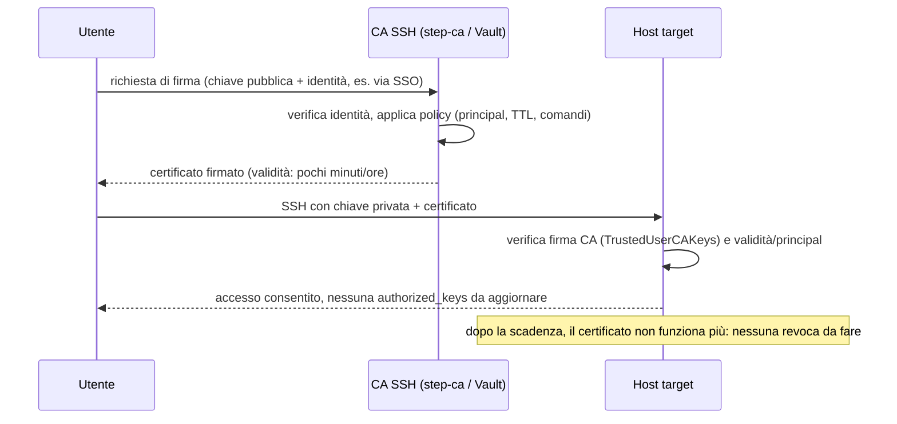

## Perché conta

[L'hardening di SSH]() elimina le password, ma lascia un
problema che le chiavi pubbliche non risolvono da sole: ogni chiave autorizzata è una riga in
`~/.ssh/authorized_keys`, su ogni host, per ogni utente. Quando un dipendente se ne va, bisogna
trovare e rimuovere la sua chiave da centinaia di server. Quando un laptop viene compromesso, la
sua chiave resta valida finché qualcuno non la revoca ovunque, a mano. Non c'è scadenza: una chiave
generata nel 2019 e mai più ruotata è ancora perfettamente valida oggi.

Una **CA SSH** inverte il problema. Gli host non si fidano più di un elenco di chiavi pubbliche
dei singoli utenti: si fidano di un'unica chiave pubblica, quella della CA. Un utente non si
autentica più con la sua chiave nuda, ma con un **certificato** che la CA ha firmato e che scade da
solo dopo pochi minuti o poche ore. Rimuovere l'accesso di qualcuno non richiede più toccare
nessun host: basta smettere di firmargli nuovi certificati.

## Come funziona

Il modello è lo stesso di una PKI X.509, ma più semplice: niente catena di CA intermedie, niente
OCSP, un solo formato binario definito da OpenSSH stesso.



Un certificato SSH per utente contiene, tra gli altri campi, la chiave pubblica da certificare, il
tipo (`user` o `host`), uno o più **principal** (gli username per cui è valido), una finestra di
validità (`valid_after`/`valid_before`) e opzionalmente estensioni che limitano cosa si può fare
(no port-forwarding, no agent-forwarding, un comando forzato). Tutto questo è firmato con la chiave
privata della CA, e la firma è quello che `sshd` verifica — non serve conoscere la singola chiave
dell'utente, basta fidarsi della CA.

## Creare la CA e firmare un certificato utente

Per i test, una CA SSH è semplicemente una coppia di chiavi come un'altra:

```bash
# Chiave della CA (da proteggere come il segreto più critico dell'infrastruttura:
# meglio HSM/Vault/step-ca in produzione, non un file su un laptop)
ssh-keygen -t ed25519 -f ssh_ca -C "ssh-user-ca" -N ""

# L'utente genera (o ha già) la propria coppia di chiavi, come sempre
ssh-keygen -t ed25519 -f id_ed25519_utente -N ""

# La CA firma la chiave pubblica dell'utente: nasce un certificato a breve vita
ssh-keygen -s ssh_ca -I "mrossi-2026-11-11" \
    -n mrossi,deploy \
    -V +8h \
    id_ed25519_utente.pub
```

Il risultato è `id_ed25519_utente-cert.pub`: non una nuova chiave, ma la chiave originale più la
firma della CA, i principal (`mrossi`, `deploy`) e la finestra di validità di 8 ore. `ssh` lo usa
automaticamente se si trova accanto alla chiave privata con quel suffisso, senza bisogno di
flag aggiuntivi lato client.

## La difesa: configurare il server per fidarsi della CA

Lato `sshd`, l'unica cosa da cambiare è dire al server di fidarsi della chiave pubblica della CA
invece di gestire `authorized_keys` per ogni utente:

```nginx {hl_lines=[2,5,8]}
# /etc/ssh/sshd_config
TrustedUserCAKeys /etc/ssh/ssh_ca.pub

# Mappa i principal del certificato ai veri username di sistema
AuthorizedPrincipalsFile /etc/ssh/principals/%u

# Revoca immediata: elenco di chiavi/certificati da rifiutare comunque,
# utile se un certificato a validità lunga viene compromesso prima di scadere
RevokedKeys /etc/ssh/revoked_keys.kh

PasswordAuthentication no
PubkeyAuthentication yes
```

Con questa configurazione, `authorized_keys` può restare vuoto o non esistere: `sshd` accetta
qualunque chiave che arrivi con un certificato valido firmato dalla CA, con un principal presente
in `AuthorizedPrincipalsFile` e non scaduto. Non c'è più nessuna chiave statica da propagare,
ruotare o cancellare host per host: il controllo di accesso si fa in un solo posto, al momento
della firma.

`RevokedKeys` resta una rete di sicurezza per i casi in cui serve invalidare qualcosa *prima* della
scadenza naturale — ad esempio la chiave stessa della CA, o un certificato con TTL anomalo emesso
per errore — ma con TTL di poche ore l'uso quotidiano smette quasi del tutto di dipendere dalle
liste di revoca, che sono esattamente il punto debole operativo delle chiavi statiche.

## Lab

Obiettivo: configurare una mini CA SSH locale e osservare un certificato che smette di funzionare
alla scadenza, senza toccare il server.

1. Generate `ssh_ca` e una coppia utente come negli esempi sopra, su una VM di prova.
2. Impostate `TrustedUserCAKeys` sul server puntando alla chiave pubblica della CA e riavviate
   `sshd`.
3. Firmate un certificato con `-V +2m` (due minuti) e collegatevi: l'accesso funziona.
4. Aspettate la scadenza e riprovate con lo stesso certificato, senza firmarne uno nuovo.


<details>
<summary><strong>Cosa osservare e perché succede</strong></summary>
<p>Dopo i due minuti, <code>ssh</code> rifiuta il certificato con un errore del tipo
<em>"Certificate invalid: expired"</em>, anche se la chiave privata dell'utente è identica a
prima e il server non ha subito nessuna modifica. La differenza non è nella chiave: è nel
certificato, che porta una finestra di validità firmata dalla CA e verificata localmente da
<code>sshd</code> confrontando l'orario del certificato con l'orologio del sistema (da cui
l'importanza di NTP sincronizzato su tutti gli host). Per tornare ad avere accesso basta
richiedere alla CA un nuovo certificato con la stessa chiave: non serve toccare
<code>authorized_keys</code> né riconfigurare nulla sul server. È esattamente questo
disaccoppiamento — identità lato CA, verifica lato host — che rende la revoca degli accessi
un'operazione singola invece che un'operazione per ogni macchina.</p>
</details>


## Conclusione

Una CA SSH non aggiunge un nuovo livello di sicurezza crittografica rispetto alle chiavi pubbliche
classiche: usa la stessa crittografia, ma cambia dove vive la fiducia. Da un elenco di chiavi
replicato su ogni host, a un'unica firma verificata localmente, con una scadenza che fa il lavoro
che altrimenti richiederebbe revoca manuale. È lo stesso principio di [Zero Trust]():
niente credenziale a lunga vita che, se sottratta, resta valida indefinitamente.

**Prossimo nella serie:** … · [Torna alla roadmap]()
