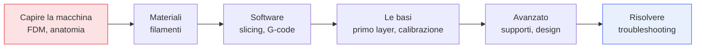

## Perché questa serie

La stampa 3D è passata da hobby di nicchia a strumento in casa, in ufficio, in laboratorio. Ma il
salto tra "ho comprato una stampante" e "stampo ciò che voglio, bene, al primo tentativo" è pieno di
frustrazioni: primo layer che non attacca, fili sottili ovunque, pezzi che si staccano, supporti
impossibili da rimuovere. Quasi tutti questi problemi hanno una causa comprensibile e una soluzione
precisa. Questa serie in **10 capitoli** è il percorso per capirle.

## L'ambito: FDM

Ci concentriamo sulla **FDM** (Fused Deposition Modeling), la tecnologia a filamento fuso: è la più
diffusa, economica e versatile, quella della stragrande maggioranza delle stampanti desktop. La
stampa a **resina** (SLA/MSLA) è un mondo diverso e complementare, che citeremo dove utile ma non è
il focus: meriterebbe una serie propria.

## La mappa

Si parte dal *capire la macchina* (come deposita la plastica, da quali parti è fatta), si passa ai
*materiali* e al *software* che traduce un modello in istruzioni, poi alle *basi* che determinano il
90% dei risultati (primo layer e calibrazione), quindi alle tecniche *avanzate* (supporti, progettare
pensando alla stampa) e infine al *troubleshooting* sistematico dei difetti.

## La filosofia: capire, non indovinare

Il filo conduttore è trasformare la stampa 3D da magia imprevedibile a processo comprensibile. Ogni
difetto è un sintomo con una causa fisica: plastica troppo calda o troppo fredda, troppo veloce o
troppo lenta, troppa o troppo poca. Chi capisce *perché* un pezzo esce male smette di cambiare dieci
parametri a caso e ne cambia *uno*, quello giusto. È lo stesso spirito pratico delle altre serie del
blog, applicato all'atelier invece che al data center.

## A chi si rivolge

A chi ha (o sta per comprare) una stampante FDM e vuole smettere di sprecare filamento in tentativi
falliti. Non servono prerequisiti: partiamo da come la plastica diventa un oggetto. Partiamo proprio
da lì, nel primo capitolo: come funziona la FDM.
