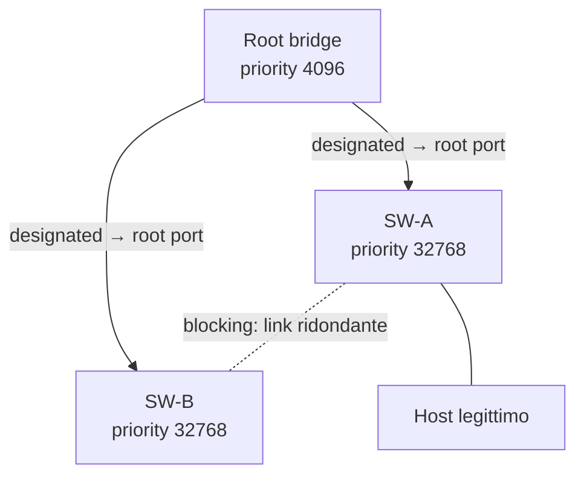

## Perché conta

Una rete switchata con link ridondanti ha un problema di base: un frame broadcast in un anello non muore
mai. Lo Spanning Tree Protocol (IEEE 802.1D, poi RSTP 802.1w) lo risolve costruendo un albero logico senza
cicli: alcuni link restano attivi, altri vengono bloccati. Il prezzo è che gli switch si scambiano
messaggi di controllo, i **BPDU** (Bridge Protocol Data Unit), senza nessuna autenticazione: chi invia un
BPDU "migliore" di quelli già in circolazione viene creduto sulla parola.

Per chi è collegato a una normale porta d'accesso — un cavo in una sala riunioni, una presa non sorvegliata —
questo significa poter ridisegnare la topologia e diventare il centro dell'albero, con tutto il traffico
inter-switch che passa da lì. È un attacco della stessa famiglia di
[ARP spoofing]() e
[VLAN hopping](), ma con un impatto potenzialmente
più ampio, perché agisce sulla topologia e non solo sul traffico di un singolo host.

## Come funziona

Gli switch eleggono un **root bridge**: vince il *Bridge ID* più basso, cioè la coppia
(priority, MAC). La priority di default è 32768. Ogni altro switch sceglie poi la sua **root port**, cioè
il percorso a costo minimo verso il root, dove il costo cumulato lungo un cammino è

$$C_{\text{path}} = \sum_{i \in \text{link}} c(i)$$

con $c(i)$ legato alla velocità della porta (in RSTP: 2.000.000 per 10 Mb/s, fino a 2 per 10 Gb/s). Le
porte che creerebbero un ciclo vengono messe in stato *blocking* (STP) o *discarding* (RSTP).



Se in rete compare un BPDU con un Bridge ID più basso di quello del root attuale, la topologia viene
ricalcolata: il nuovo mittente diventa root. Durante il ricalcolo le porte passano da *listening* a
*learning* a *forwarding* (30-50 s in STP classico, molto meno in RSTP) e il traffico su quel segmento si
interrompe mentre la tabella MAC viene ricostruita.

## L'attacco

Il meccanismo d'attacco è concettualmente semplice: un dispositivo collegato a una porta d'accesso che
dovrebbe essere "foglia" dell'albero inizia invece a partecipare attivamente a STP, annunciandosi con una
priority più bassa di quella del root legittimo (il valore minimo possibile è 0). Qualunque switch o host
capace di generare BPDU — compreso un normale bridge Linux configurato con `stp_state 1` e priorità 0 — può
farlo, perché lo standard non prevede né autenticazione né controllo su chi ha il diritto di candidarsi a
root.

Le conseguenze pratiche di un root takeover riuscito sono tre:

- **Intercettazione:** diventando il centro dell'albero, il traffico tra gli switch di accesso coinvolti
  passa dal dispositivo dell'attaccante, che può osservarlo o alterarlo.
- **Denial of service:** BPDU che annunciano continui cambi di topologia (*topology change notification*)
  costringono gli switch a invalidare e ricostruire le tabelle MAC, con un effetto di flooding simile a
  quello di un [MAC flooding]() prolungato nel tempo.
- **Instabilità:** anche un tentativo mal riuscito, con un Bridge ID che non vince l'elezione, può comunque
  far rivalutare costi e porte designate, causando micro-interruzioni percepibili dagli host.

L'unico prerequisito è l'accesso fisico (o via Wi-Fi bridgato) a una porta che non impedisce la
partecipazione a STP: nessun bypass di autenticazione, nessuna vulnerabilità software, solo l'assenza di
un controllo che il protocollo stesso non prevede.

## La difesa

Il principio è: **le porte di accesso non devono mai partecipare all'elezione STP**, e le porte che la rete
di distribuzione sa già dover essere "foglie" non devono mai poter superare l'elezione corrente. Su un
bridge Linux i parametri equivalenti si impostano per-porta con `ip link` / `bridge`:

```bash {hl_lines=[3,4]}
ip link add br0 type bridge stp_state 1
ip link set eth0 master br0
bridge link set dev eth0 guard on      # BPDU guard: scarta i BPDU in ingresso, disabilita la porta
bridge link set dev eth0 root_block on # root guard: ignora i BPDU che proporrebbero un root migliore
ip link set br0 up
```

Le due righe evidenziate sono il nucleo della difesa:

- **BPDU Guard** (`guard on`) presume che su quella porta non debba *mai* arrivare un BPDU. Se ne arriva
  uno, la porta viene posta in errore (err-disabled su Cisco) invece di essere semplicemente ignorata:
  il link cade, ma in modo visibile e allarmabile, non in modo silenzioso. Va applicato a tutte le porte
  verso host finali, idealmente insieme a *PortFast* (che salta gli stati intermedi di convergenza su
  porte che sai essere foglie).
- **Root Guard** (`root_block on`) è più permissivo: la porta continua a partecipare a STP, ma se riceve
  un BPDU che la farebbe diventare root port — cioè che annuncia un root migliore di quello attuale —
  lo scarta e mette la porta in stato *root-inconsistent* finché i BPDU "sospetti" non cessano. È lo
  strumento giusto per le porte verso altri switch di cui non ti fidi completamente (un collegamento
  interno verso un'altra unità organizzativa, un fornitore).

Un terzo controllo complementare, utile dove il traffico può essere monitorato, è l'allarme su ogni
cambio di root bridge o su un numero anomalo di *topology change*: un root bridge che cambia MAC senza
una manutenzione pianificata è quasi sempre un sintomo da inviare al SIEM (vedi
[SIEM e correlazione dei log]()).

## Lab

Con tre nodi Linux in bridge sulla stessa rete (containerlab o namespace di rete vanno bene):

1. Crea `br0` su due nodi "switch" con `stp_state 1` e priorità di default, collegali con un link
   ridondante e osserva con `bridge -d link show` quale porta finisce in stato *blocking*.
2. Imposta `root_block on` sulla porta di accesso di uno dei due nodi "switch" verso il terzo nodo
   ("host"). Sul nodo host, crea a tua volta un bridge con priorità 0 sulla stessa interfaccia e
   osserva cosa succede sulla porta protetta rispetto a una porta identica senza la protezione.
3. Ripeti il punto 2 con `guard on` invece di `root_block on`: che differenza di stato osservi sulla
   porta dello switch?


<details><summary>Soluzione</summary>
<ol>
<li>Il link ridondante crea un ciclo nell'albero: una delle due porte che lo chiudono passa in
<em>blocking</em> (o <em>discarding</em> in RSTP), mentre l'altra resta <em>forwarding</em>. Lo stato è
visibile nel campo <code>state</code> di <code>bridge -d link show</code>.</li>
<li>Sulla porta con <code>root_block on</code>, i BPDU che annuncerebbero il nodo host come root migliore
vengono scartati e la porta entra in stato <em>root-inconsistent</em>: continua a esistere ma non accetta
quel root. Senza la protezione, lo switch ricalcola l'albero e il nodo host diventa root bridge.</li>
<li>Con <code>guard on</code> la porta non si limita a scartare i BPDU: viene disabilitata del tutto
(errdisable) non appena ne riceve uno, perché quella porta non dovrebbe mai vederne. È il comportamento
corretto per una porta che la topologia prevede come foglia, non come collegamento tra switch.</li>
</ol>
</details>


## Conclusione

STP risolve un problema reale — i loop di layer 2 — fidandosi implicitamente di chiunque sappia parlare
il protocollo. Su una rete moderna questo si corregge non disabilitando STP, ma restringendo dove può
parlare: PortFast e BPDU Guard sulle porte di accesso, Root Guard sulle porte verso segmenti meno fidati,
e un allarme su ogni cambio di root bridge inatteso.

**Prossimo nella serie:** [Torna alla roadmap]()
