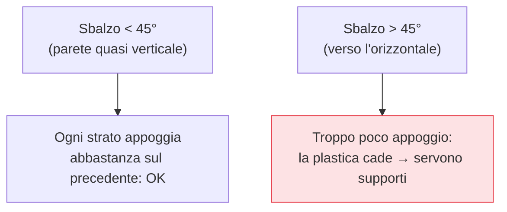

## Perché conta

Il [primo limite naturale]() della FDM torna qui in tutta la
sua forza: **non si può depositare plastica nel vuoto**. Ogni strato ha bisogno di qualcosa sotto su
cui appoggiarsi. Quando la geometria va "in fuori" oltre un certo punto, servono **supporti**
(strutture temporanee) — oppure, meglio, un **orientamento** che li eviti. Questo capitolo è
sull'equilibrio tra i due, perché il miglior supporto è quello che non devi stampare.

## La regola dei 45 gradi



La regola pratica: un **sbalzo (overhang)** fino a circa **45°** dalla verticale si stampa bene senza
supporti, perché ogni strato poggia a sufficienza sul precedente. Oltre i 45°, l'appoggio è troppo
scarso e la plastica si affloscia: servono supporti. Il valore esatto dipende da raffreddamento e
velocità, ma 45° è la soglia da tenere a mente.

## Ponti: il caso speciale

Un **ponte (bridge)** è un tratto orizzontale sospeso tra due punti alti. Sorprendentemente, la FDM
lo gestisce bene entro certe distanze: la plastica viene "tesa" tra i due appoggi e, con buon
raffreddamento, solidifica prima di cadere. Per questo un foro orizzontale spesso non ha bisogno di
supporti sulla sommità. Oltre una certa luce, però, il ponte cede: lì servono supporti o un
ripensamento della geometria.

## Il problema dei supporti

I supporti risolvono gli sbalzi ma hanno un costo reale:

```text {hl_lines=[2,3]}
Svantaggi dei supporti:
  - vanno RIMOSSI a mano → tempo, rischio di rovinare il pezzo
  - lasciano cicatrici sulla superficie di contatto → finitura brutta dove toccano
  - sprecano filamento e tempo di stampa
→ per questo: meglio EVITARLI con l'orientamento che aggiungerne tanti
```

Tipi e impostazioni che ne riducono la fatica: supporti **ad albero** (toccano meno il pezzo), una
*z-distance* ben tarata (abbastanza staccati da venir via, abbastanza vicini da reggere), e materiali
di supporto solubili nelle macchine a doppio estrusore.

## L'orientamento: la scelta a monte

Prima di aggiungere supporti, chiediti: *posso ruotare il pezzo?* L'orientamento influenza quattro
cose insieme, spesso in conflitto:

- **Supporti necessari**: ruotare per portare gli sbalzi sotto i 45° può azzerarli.
- **Resistenza**: gli strati sono deboli lungo Z; orienta in modo che il carico corra *lungo* gli
  strati, non attraverso — come visto per l'[anisotropia]().
- **Qualità delle superfici**: la faccia a contatto col piano e quelle toccate dai supporti vengono
  peggio; metti in basso ciò che non si vede.
- **Tempo**: più alto è il pezzo, più strati, più tempo.

Spesso non esiste l'orientamento perfetto: si sceglie quale proprietà privilegiare per *quel* pezzo. È
una decisione di compromesso, esattamente come nello [slicing]().


<details>
<summary><strong>Domanda:</strong> se i supporti si possono generare automaticamente nello slicer, perché preoccuparsi dell'orientamento? Lascio che il software metta i supporti dove servono e stampo.</summary>
<p>Perché i supporti automatici risolvono il problema geometrico ("niente plastica nel vuoto") ma ti
lasciano in eredità tre problemi che l'orientamento, scelto a monte, può evitare del tutto — e "lascio
fare al software" significa accettarli tutti e tre senza nemmeno accorgertene. Primo, la
<em>superficie</em>: ovunque un supporto tocchi il pezzo, lascia una cicatrice ruvida, perché lì la
plastica è stata depositata su una struttura imperfetta invece che nel vuoto o sul piano liscio. Lo
slicer non sa quali facce del tuo oggetto sono "in vista" e quali no: mette supporti dove la geometria li
richiede, non dove rovinano meno. Orientando tu, puoi mandare gli sbalzi su facce nascoste e tenere pulite
quelle estetiche. Secondo, la <em>resistenza</em>: questo lo slicer lo ignora completamente. I supporti
automatici non cambiano l'anisotropia del pezzo — se l'orientamento che li minimizza mette anche gli
strati perpendicolari al carico, otterrai un pezzo pieno di supporti <em>e</em> fragile nel punto
sbagliato. Solo tu sai dove arriverà la forza, quindi solo tu puoi orientare per far correre lo sforzo
lungo gli strati. Terzo, il <em>lavoro e il rischio</em>: ogni supporto va rimosso a mano, costa tempo,
spreca filamento, allunga la stampa, e la rimozione può scheggiare o rompere dettagli fini — a volte il
pezzo si danneggia proprio togliendo i supporti. Un orientamento che dimezza i supporti dimezza tutto
questo. C'è poi un punto di metodo: i supporti automatici sono una <em>rete di sicurezza</em>, non una
strategia. L'approccio maturo è prima chiedersi "come oriento per averne il meno possibile, con gli
sbalzi su facce nascoste e gli strati nella direzione giusta?", sfruttare il fatto che fino a 45° e sui
ponti brevi non servono affatto, eventualmente spezzare il modello in parti più facili da stampare e
incollare dopo, e <em>solo allora</em> lasciare che lo slicer metta i supporti là dove restano
inevitabili. Delegare tutto al software non è sbagliato per un pezzo buttato via o un prototipo rapido;
ma per qualcosa che deve essere bello o resistere, l'orientamento è una decisione tua che il generatore
di supporti non può prendere al posto tuo, perché non conosce né l'estetica né i carichi del tuo pezzo.</p>
</details>


## Conclusione

La FDM non stampa nel vuoto: oltre i 45° servono supporti, strutture di sacrificio che costano tempo,
filamento e finitura — mentre i ponti brevi se la cavano da soli. Il miglior supporto è quello evitato
orientando il pezzo, scelta che bilancia supporti, resistenza, estetica e tempo. Molte di queste
difficoltà, però, si risolvono ancora prima: *progettando* il modello pensando a come verrà stampato.
È la progettazione per la stampa 3D, prossimo capitolo.
