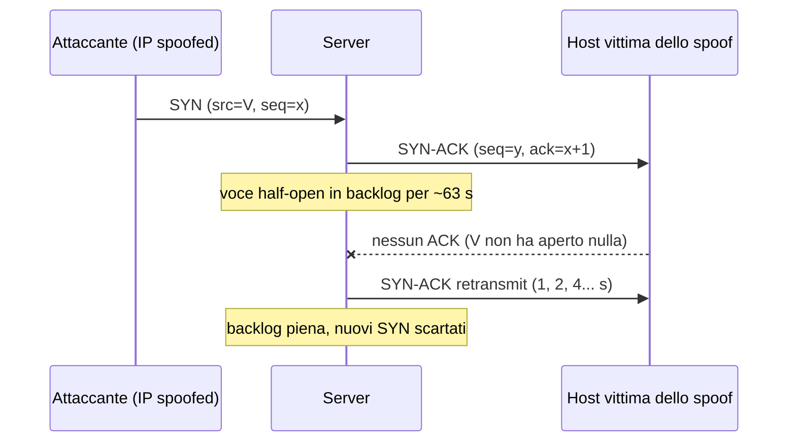

Un three-way handshake costa all'attaccante un solo pacchetto da 60 byte. Costa al server memoria, timer e una voce in una tabella di dimensione fissa. Questa asimmetria è il cuore del **SYN flood**, uno degli attacchi DoS più vecchi (1996) e ancora in circolazione: non satura la banda, satura lo *stato*. Nell'articolo sull'[anatomia dei DDoS]() lo avevamo citato in una riga; qui lo apriamo.

## Perché conta

Quando arriva un SYN su una porta in ascolto, il kernel crea una **half-open connection** e risponde con un SYN-ACK. Se il client non completa l'handshake con l'ACK finale, la voce resta in memoria finché i retransmit del SYN-ACK non si esauriscono. Se l'indirizzo sorgente è falsificato, l'ACK non arriverà mai.

Il tempo di permanenza è dato dai retransmit con backoff esponenziale. Con `tcp_synack_retries=5` (default Linux) i tentativi avvengono a 1, 2, 4, 8, 16 e 32 secondi, quindi:

$$T = \sum_{i=0}^{5} 2^i = 63\ \text{s}$$

Per la legge di Little il numero medio di voci occupate è $N = \lambda T$, dove $\lambda$ è il tasso di SYN. La coda è piena quando $N$ raggiunge la backlog $B$, cioè a:

$$\lambda_{crit} = \frac{B}{T} = \frac{256}{63} \approx 4\ \text{SYN/s}$$

Quattro pacchetti al secondo bastano a tenere fuori i client legittimi da un servizio con backlog 256. Non serve una botnet.

## Come funziona



I **SYN cookies** (D. J. Bernstein, 1996) tolgono lo stato dal problema: quando la backlog è satura il server non memorizza nulla, ma codifica le informazioni necessarie *dentro il numero di sequenza* del SYN-ACK. Lo schema classico è:

- 5 bit: un contatore temporale $t$ (cambia ogni 64 s);
- 3 bit: indice della MSS in una tabella di 8 valori;
- 24 bit: un hash crittografico di (IP e porta sorgente, IP e porta destinazione, $t$, segreto del server).

Se arriva un ACK, il server ricalcola l'hash: se $ack-1$ corrisponde a un cookie valido ricostruisce la connessione, altrimenti scarta. Un attaccante che indovina alla cieca ha probabilità $2^{-24} \approx 6 \cdot 10^{-8}$ per tentativo. Il prezzo: si perdono le opzioni TCP non codificate (Linux le recupera in parte dal timestamp, quando attivo), per questo i cookie scattano solo a backlog piena.

## L'attacco

Con `hping3` basta una riga per generare un flood da lab (da eseguire **solo** su una rete di test che controlli):

```bash
# SYN flood su 192.0.2.10:80 con sorgenti casuali, 1000 pkt/s
sudo hping3 -S -p 80 --rand-source -i u1000 192.0.2.10

# Sul bersaglio: contare le voci half-open
ss -ant state syn-recv | wc -l
nstat -az TcpExtTCPReqQFullDrop TcpExtSyncookiesSent
```

Con `tcp_syncookies=0` il contatore `TcpExtTCPReqQFullDrop` sale e i client reali ricevono timeout. Con i cookie attivi sale `TcpExtSyncookiesSent` e il servizio continua a rispondere. Attenzione al falso senso di sicurezza: i cookie salvano la memoria, ma il flood continua a consumare CPU e banda, e un attacco con **ACK flood** valido (non spoofato) supera comunque lo schema.

## La difesa

Primo livello, il kernel. Il valore `1` abilita i cookie solo in overflow, `2` li forza sempre (utile per test).

```bash
# /etc/sysctl.d/90-tcp-flood.conf
net.ipv4.tcp_syncookies = 1
net.ipv4.tcp_max_syn_backlog = 4096
net.ipv4.tcp_synack_retries = 3
net.core.somaxconn = 4096
```

Ridurre i retransmit a 3 abbassa $T$ a $1+2+4+8=15$ s e quadruplica $\lambda_{crit}$ a parità di backlog. Secondo livello, **synproxy** di nftables: il firewall completa l'handshake con il client *al posto* del server e inoltra la connessione solo dopo l'ACK valido, così l'applicazione non vede mai i SYN spoofati.

```nft {hl_lines=[4,10,11]}
table inet raw {
  chain prerouting {
    type filter hook prerouting priority raw; policy accept;
    tcp dport 80 tcp flags syn notrack
  }
}
table inet filter {
  chain input {
    type filter hook input priority filter; policy drop;
    tcp dport 80 ct state invalid,untracked synproxy mss 1460 wscale 7 timestamp sack-perm
    ct state invalid drop
    ct state established,related accept
  }
}
```

La riga 4 (`notrack` sui SYN) evita che conntrack crei lo stato per pacchetti non ancora validati; le righe 10-11 gestiscono l'handshake e scartano il resto. Serve anche `sysctl -w net.netfilter.nf_conntrack_tcp_loose=0`, altrimenti conntrack accetta ACK senza SYN e il proxy viene aggirato.

## Lab

In un laboratorio con due network namespace (`ip netns add`) o con [containerlab]():

1. Avvia `python3 -m http.server 80` nel namespace del server con `tcp_syncookies=0` e `tcp_max_syn_backlog=128`.
2. Lancia `hping3 --flood` dall'attaccante e prova `curl` dal client: misura il tempo di risposta.
3. Riabilita i cookie e ripeti. Cosa cambia in `nstat`? Calcola $\lambda_{crit}$ per i parametri scelti.


<details><summary>Soluzione</summary>
<p>Con <code>tcp_syncookies=0</code> e backlog 128, $\lambda_{crit}=128/63\approx 2$ SYN/s: il <code>curl</code> va in timeout dopo pochi secondi di flood e <code>TcpExtTCPReqQFullDrop</code> cresce. Con <code>tcp_syncookies=1</code> <code>TcpExtSyncookiesSent</code> cresce, la backlog resta saturata ma le connessioni legittime completano, con un lieve ritardo dovuto alla CPU. Abbassando <code>tcp_synack_retries</code> a 3 il tempo di permanenza scende da 63 s a 15 s e la soglia sale a $128/15\approx 8.5$ SYN/s: utile, ma non sostituisce i cookie.</p>
</details>


## Conclusione

Il SYN flood funziona perché TCP alloca stato prima di autenticare il peer. I SYN cookies spostano quello stato nel pacchetto, synproxy lo sposta sul firewall, e il tuning dei timer allarga il margine. Nessuno dei tre ferma un attacco volumetrico: per quello serve la mitigazione a monte vista in [RTBH e Flowspec](), e il filtro dell'origine spoofata con [BCP 38]() toglie alla radice il presupposto dell'attacco.

**Prossimo nella serie:** … · [Torna alla roadmap]()
