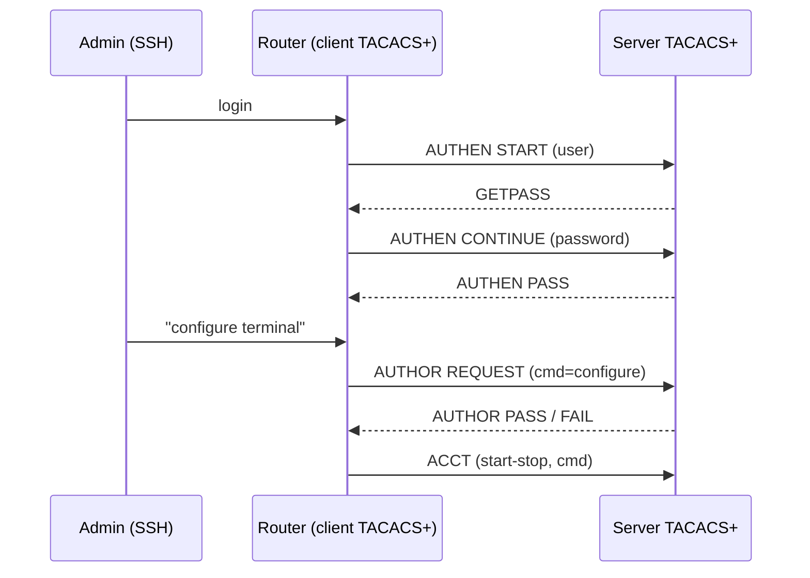

## Perché conta

Chi entra in un router o in uno switch con privilegi amministrativi controlla la rete: può deviare traffico, disattivare ACL, aprire tunnel verso l'esterno. Gli account locali sui dispositivi non scalano, non si revocano in fretta quando una persona lascia il team e non lasciano un registro centrale di *chi ha digitato cosa*. Per questo si usa **AAA**: *Authentication* (chi sei), *Authorization* (cosa puoi fare), *Accounting* (cosa hai fatto).

Due protocolli dominano il campo. **RADIUS** (RFC 2865) è nato per l'accesso dial-up e oggi è alla base anche di [802.1X e NAC](). **TACACS+** (RFC 8907) è pensato specificamente per l'amministrazione degli apparati di rete. Hanno modelli di sicurezza molto diversi, e confonderli porta a configurare male entrambi.

## Come funziona

Differenze che contano operativamente:

- **RADIUS**: trasporto UDP, combina *authentication* e *authorization* in un solo scambio, cifra **solo** il campo password con un digest MD5 derivato dalla shared key; il resto del pacchetto (username, attributi, ACL assegnate) viaggia in chiaro. L'integrità delle risposte del server si appoggia a un `Response Authenticator`, anch'esso basato su MD5.
- **TACACS+**: trasporto TCP sulla porta 49, separa le tre funzioni AAA in scambi distinti e offusca l'**intero body** del pacchetto, inclusi gli attributi. Permette di autorizzare *per singolo comando*, non solo al login.



L'"offuscamento" di TACACS+ non è cifratura nel senso moderno: il body viene messo in XOR con un flusso di pad generato concatenando iterazioni di MD5 su `session_id`, shared key, versione e numero di sequenza. Indicando con $\parallel$ la concatenazione e con $P$ il body in chiaro, il body trasmesso è

$$C = P \oplus \text{pad}(\text{session\_id},\, \text{key},\, \text{version},\, \text{seq\_no})$$

L'RFC 8907 è esplicito su questo punto: l'offuscamento **non sostituisce** una cifratura vera, non garantisce integrità né protezione dal replay a livello di protocollo, e raccomanda di non usare TACACS+ su reti che l'attaccante può osservare senza un trasporto aggiuntivo (TLS, o un tunnel IPsec/VPN dedicato alla gestione).

## L'attacco

Il punto debole comune a entrambi i protocolli è lo stesso: tutta la sicurezza dipende da una **shared key statica**, spesso riusata su decine di apparati e raramente ruotata. Con MD5 come primitiva, sia il pad di TACACS+ sia il meccanismo di cifratura password di RADIUS sono stati progettati in un'epoca in cui MD5 era considerato accettabile; oggi non lo è più per nuovi protocolli, ma resta incastonato in questi standard per compatibilità.

Due scenari concreti, entrambi senza bisogno di rompere alcuna crittografia:

1. **Cattura su un segmento di gestione mal segmentato.** Se il traffico AAA passa su una VLAN raggiungibile da host non amministrativi (magari via un [port mirror mal configurato]()), chi lo osserva impara username, pattern degli attributi RADIUS e strutture TACACS+ anche senza recuperare la key, utile per pianificare un attacco successivo o un replay se la shared key è debole.
2. **Blast-RADIUS (CVE-2024-3596).** Nel 2024 un gruppo di ricercatori ha pubblicato un attacco pratico contro RADIUS su UDP non protetto da RadSec: un attaccante *on-path* capace di generare collisioni MD5 può falsificare il `Response Authenticator` di un `Access-Accept`, trasformando un `Access-Reject` in un login accettato senza conoscere la shared key. È la prova che l'uso di MD5 in RADIUS non era solo un problema teorico, e ha spinto IETF e vendor a raccomandare con forza il passaggio a RadSec (RADIUS su TLS, RFC 6614) o a MACsec sul segmento di gestione.

La difesa in entrambi i casi non è "patchare un bug": è non esporre mai il traffico AAA su una rete che un attaccante può osservare o posizionarsi in mezzo, e non riusare la stessa shared key su più dispositivi.

## La difesa

Prima regola: la gestione viaggia su una VLAN/VRF dedicata, mai sulla stessa rete dei dati utente. Seconda regola: ogni NAS (router, switch, firewall) ha una propria shared key, generata a caso e lunga almeno 32 caratteri, ruotata periodicamente. Terza regola: autenticazione locale di **fallback** sempre presente, per non restare chiusi fuori se il server AAA è irraggiungibile.

Configurazione Cisco IOS con TACACS+ primario e fallback locale, autorizzazione dei comandi e accounting:

```text {hl_lines=[1,2,8,9,13,14]}
aaa new-model
tacacs server TACSRV1
 address ipv4 10.10.99.10
 key 7 <shared-key-lunga-e-unica>
 timeout 3

aaa group server tacacs+ ADMIN-AAA
 server name TACSRV1

aaa authentication login default group ADMIN-AAA local
aaa authorization exec default group ADMIN-AAA local
aaa authorization commands 15 default group ADMIN-AAA local
aaa accounting commands 15 default start-stop group ADMIN-AAA
aaa accounting exec default start-stop group ADMIN-AAA

! interfaccia di gestione isolata, solo verso il server AAA
ip access-list standard MGMT-ONLY
 permit 10.10.99.0 0.0.0.255
```

Per RADIUS, lo stesso principio vale lato server: `freeradius` con RadSec invece di UDP in chiaro quando il trasporto non è già protetto da una VPN o da MACsec dedicati alla gestione:

```text {hl_lines=[2,3,4]}
listen {
    type = auth
    ipaddr = *
    port = 2083
    tls {
        certdir = /etc/raddb/certs
        cert_file = ${certdir}/server.pem
        ca_file = ${certdir}/ca.pem
    }
}
```

Infine, l'accounting non è un di più: ogni comando eseguito con privilegio 15 finisce nei log del server TACACS+, che diventano la fonte di verità per un'indagine, indipendente dai log locali del dispositivo che un attaccante con accesso admin potrebbe cancellare.

## Lab

Con containerlab (due nodi: un router FRR/VyOS come client AAA e un container `freeradius` o un server TACACS+ come `tac_plus`), configura l'autenticazione amministrativa verso il server e osserva cosa succede quando il server non risponde.

1. Configura `aaa authentication login default group <AAA> local` e verifica che, spegnendo il container del server, il login locale funzioni ancora come fallback.
2. Cattura il traffico TACACS+ con `tcpdump -i eth1 -w aaa.pcap tcp port 49` durante un login: apri il pcap in Wireshark e verifica che il body non sia leggibile in chiaro.
3. Cambia la shared key solo sul client (non sul server) e osserva nel log del server l'errore di decodifica: cosa ti dice questo sulla capacità di rilevare una key sbagliata senza un canale fuori banda?


<details><summary>Soluzione</summary>
<p>1. Con <code>aaa authentication login default group ADMIN-AAA local</code> il router prova il gruppo TACACS+ e, solo se irraggiungibile (non se rifiuta la password), scende al metodo locale: è così che si evita il <em>lockout</em> totale se il server AAA è down, mantenendo comunque la password locale sotto controllo rigoroso.</p>
<p>2. Il body del pacchetto <code>AUTHEN START</code>/<code>CONTINUE</code> appare come byte apparentemente casuali in Wireshark: solo l'header (versione, tipo, sequenza, lunghezza) resta leggibile, perché l'offuscamento XOR copre tutto il resto.</p>
<p>3. Il server segnala un errore di decodifica o un pacchetto malformato, perché il pad calcolato con la key sbagliata non coincide: è un segnale operativo utile (mismatch di configurazione) ma anche un indizio che un attaccante senza la key giusta non supera comunque l'autenticazione, perché il server scarta pacchetti che non si decodificano in una struttura valida.</p>
</details>


## Conclusione

TACACS+ e RADIUS risolvono lo stesso problema — centralizzare chi può amministrare cosa — con garanzie di riservatezza molto diverse: nessuno dei due è pensato per viaggiare su una rete che un attaccante osserva liberamente. La vera protezione non sta nell'algoritmo di offuscamento o di cifratura della password, ormai datato in entrambi i protocolli, ma nell'isolare il piano di gestione, usare shared key uniche e lunghe, preferire RadSec o un trasporto cifrato quando possibile, e tenere sempre un fallback locale controllato.

**Prossimo nella serie:** altri approfondimenti sull'accesso amministrativo agli apparati di rete · [Torna alla roadmap]()
