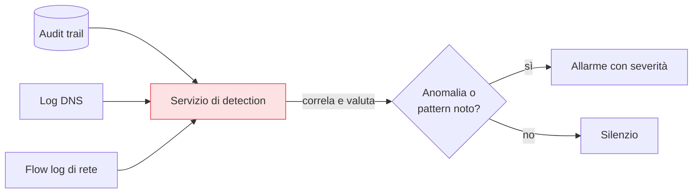

## Perché conta

L'[audit trail]() registra tutto, ma registrare non è
rilevare. In un flusso di migliaia di eventi al minuto, la singola azione malevola è un ago in un
pagliaio che nessun umano troverà a occhio. La **threat detection** è ciò che legge quel flusso in
continuazione e solleva la mano quando vede qualcosa di sospetto — trasformando i log da archivio
passivo in allarme attivo.

## Detection gestita: cosa analizza



I servizi gestiti (AWS GuardDuty, Microsoft Defender for Cloud, GCP Security Command Center) incrociano
più sorgenti — audit trail, query DNS, flow log di rete, threat intelligence — e applicano due
approcci: **firme** di comportamenti noti (comunicazione con un IP di comando-e-controllo noto,
mining di criptovalute) e **anomalie** rispetto alla baseline (un'identità che improvvisamente agisce
da un paese mai visto, a un orario anomalo, con API mai usate prima).

## Cosa rileva davvero

```text {hl_lines=[2,4,6]}
Esempi di finding tipici nel cloud:
  - credenziali usate da un IP / paese anomalo (possibile furto di chiavi)
  - escalation di privilegi (un'identità che si auto-concede permessi admin)
  - ricognizione (enumerazione massiva di risorse, bucket, ruoli)
  - esfiltrazione (download anomalo di grandi volumi da storage)
  - comunicazione con infrastruttura malevola nota (C2, mining)
```

Nota il filo: molti di questi sono i segni delle fasi d'attacco cloud descritte da **MITRE ATT&CK** —
accesso iniziale, persistenza, escalation, movimento laterale, esfiltrazione. La detection cerca
proprio queste impronte.

## Il problema vero: il rumore

Attivare la detection è facile; renderla *utile* è il lavoro. Troppi allarmi a bassa priorità e il team
smette di guardarli — la **fatica da allarmi (alert fatigue)** che fa ignorare proprio quello vero. Il
valore sta nel **tuning**: sopprimere i falsi positivi noti, alzare la priorità di ciò che tocca risorse
critiche, e instradare automaticamente gli allarmi gravi dove qualcuno (o qualcosa) reagisce davvero. Un
allarme che nessuno legge non è detection, è solo un altro log.


<details>
<summary><strong>Domanda:</strong> se attivo un servizio di detection gestito, non ho già risolto? Perché insistere sul tuning: non dovrebbe funzionare "out of the box" visto che lo gestisce il provider?</summary>
<p>Funziona out of the box nel senso che inizia subito a produrre finding corretti dal punto di vista
tecnico — ma "produce finding" e "migliora la tua sicurezza" sono due cose diverse, e il ponte tra loro
è esattamente il lavoro che il provider non può fare al posto tuo. Il servizio sa riconoscere un
comportamento anomalo, ma non sa <em>cosa è normale e importante per te</em>: non sa che quel job di
backup notturno che legge grandi volumi è legittimo, che quella pipeline che enumera risorse sta solo
facendo inventario, che quel range di IP è il tuo ufficio. Senza tuning, questi generano allarmi, si
mescolano a quelli veri, e il team — sommerso — inizia a ignorarli tutti: è la alert fatigue, e trasforma
un ottimo sistema di detection in rumore costoso. Il provider gestisce il <em>motore</em> (le regole, la
threat intelligence, l'analisi), che è tantissimo e ti risparmi di costruirlo; ma la <em>pertinenza</em>
— quali allarmi contano, dove instradarli, cosa sopprimere, cosa escalare — dipende dal tuo ambiente e
dalle tue priorità, che solo tu conosci. In più la detection è l'<em>inizio</em> di un processo, non la
fine: un allarme che non porta a un'azione (indagare, contenere, rispondere) è inutile. Il tuning e
l'integrazione con la risposta sono ciò che chiude il cerchio. "Attivato e dimenticato" ti dà la falsa
sicurezza di essere coperto mentre gli allarmi veri annegano nel rumore; "attivato e curato" ti dà
davvero l'avviso quando conta.</p>
</details>


## Conclusione

La threat detection legge il flusso di log, traffico e DNS per riconoscere firme e anomalie — furto di
credenziali, escalation, ricognizione, esfiltrazione — ma il suo valore reale dipende dal tuning che
taglia il rumore e instrada ciò che conta. La detection trova le minacce *attive*; c'è però un'altra
domanda, preventiva: la mia configurazione è sicura *prima* che qualcuno la attacchi? È il tema della
[postura di sicurezza e del CSPM](), prossimo capitolo.
