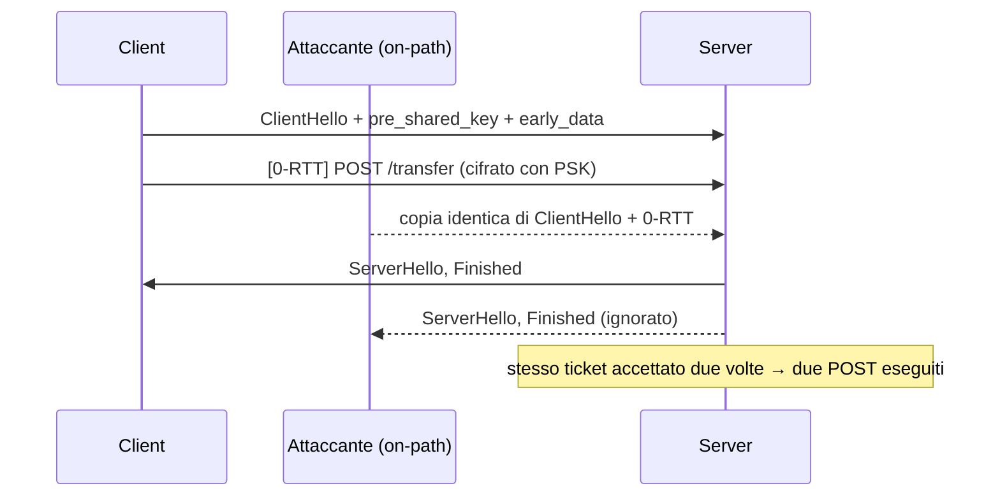

TLS 1.3 ha portato l'handshake completo a un solo round trip. Con la **resumption** si può fare meglio: il client invia dati applicativi già nel primo volo, prima ancora che l'handshake sia finito. È lo **0-RTT** (*early data*). Il prezzo è una proprietà che nel resto di TLS è garantita e qui no: l'assenza di replay. Questo articolo completa il quadro del [TLS deep dive]().

## Perché conta

Con 0-RTT il client cifra la richiesta con una chiave derivata dal **PSK** della sessione precedente, senza contributo del server. Per questo motivo:

- non c'è **forward secrecy** per l'early data: se la chiave del ticket (STEK) viene compromessa, il traffico 0-RTT registrato si decifra;
- non c'è **protezione dal replay**: chi osserva il pacchetto può rinviarlo identico al server (o a un altro nodo dello stesso cluster) e l'early data verrà accettato di nuovo.

Se la richiesta è `GET /logo.png` non succede nulla. Se è `POST /transfer?to=mallory&amount=100` ogni replay è un bonifico in più.

## Come funziona



La specifica (RFC 8446 §8) prevede tre contromisure lato server, tutte con un costo:

1. **Single-use ticket**: il server ricorda i ticket già usati. Richiede stato condiviso fra tutti i nodi.
2. **ClientHello recording**: si registra l'hash di ogni ClientHello dentro una finestra temporale e si rifiuta la finestra scaduta (*freshness check* sul `obfuscated_ticket_age`).
3. **Rifiutare early data** e fare un handshake normale a 1-RTT.

Se la finestra di accettazione è $W$ secondi e il server registra $n$ ClientHello in un Bloom filter di $m$ bit con $k$ hash, la probabilità di falso positivo (richiesta legittima scambiata per replay e scartata) è:

$$p \approx \left(1 - e^{-kn/m}\right)^k$$

Con $m = 2^{24}$, $k = 4$ e $n = 10^6$ si ha $p \approx 0{,}002$. Un attaccante però non sfrutta il falso positivo: sfrutta le **finestre non coperte**, ad esempio un secondo nodo del bilanciatore che non condivide lo stato.

## L'attacco

Il replay si riproduce in lab con `openssl` contro un server che accetta early data (solo su una rete di test che controlli):

```bash
# 1) salva il ticket di una sessione normale
echo | openssl s_client -connect lab.example.test:443 -tls1_3 -sess_out sess.pem

# 2) prepara la richiesta e invia early data
printf 'POST /transfer HTTP/1.1\r\nHost: lab.example.test\r\nContent-Length: 0\r\n\r\n' > req.txt
openssl s_client -connect lab.example.test:443 -tls1_3 \
    -sess_in sess.pem -early_data req.txt

# 3) ripeti il punto 2 con lo stesso sess.pem: se il server non ha
#    anti-replay, vedi "Early data was accepted" e il POST gira di nuovo
```

Un ticket TLS 1.3 può essere riusato più volte: `openssl` salva solo il PSK, quindi due invocazioni producono due ClientHello validi con lo stesso ticket, esattamente ciò che un attaccante on-path ottiene catturando e rinviando il pacchetto.

## La difesa

La regola è: **early data solo per richieste idempotenti**, e l'applicazione deve poterle distinguere. Con nginx si abilita lo 0-RTT e si inoltra l'informazione al backend (RFC 8470):

```nginx {hl_lines=[5,9,13,14]}
server {
    listen 443 ssl;
    ssl_protocols TLSv1.3;
    ssl_session_tickets on;
    ssl_early_data on;

    location / {
        proxy_pass http://app;
        proxy_set_header Early-Data $ssl_early_data;
    }

    # backend: rifiuta le richieste non sicure arrivate in early data
    # con "425 Too Early"; il client le ripete dopo l'handshake
}
```

Il backend legge `Early-Data: 1` e per i metodi non sicuri risponde `425 Too Early`; il client conforme ritenta la richiesta *dopo* il completamento dell'handshake, dove il replay non è possibile. Per un'API di pagamento, o ovunque ci siano effetti collaterali, la scelta più semplice è lasciare `ssl_early_data off;` (il default). Altri accorgimenti:

- ruotare spesso la chiave dei ticket e non condividerla fra ambienti diversi;
- ridurre la validità dei ticket (`ssl_session_timeout`) per stringere la finestra $W$;
- con più nodi, o si condivide lo stato anti-replay o si abilita 0-RTT solo su un livello (CDN) che risponde a richieste idempotenti.

## Lab

1. Avvia nginx con `ssl_early_data on;` e un backend che registra le richieste `POST /transfer` con l'header `Early-Data`.
2. Esegui i passi dell'attacco sopra: quante volte compare il POST nel log dopo due invocazioni con lo stesso `sess.pem`?
3. Aggiungi nel backend la regola "se `Early-Data: 1` e metodo non sicuro → 425" e ripeti. Cosa cambia? Calcola il valore di $p$ per $m = 2^{20}$, $k = 3$, $n = 10^5$.


<details><summary>Soluzione</summary>
<p>Senza protezione il POST compare due volte: nginx non mantiene stato anti-replay fra connessioni, quindi il ticket viene accettato ogni volta. Con la regola sul backend, <code>openssl</code> mostra l'early data inviato ma il server risponde <code>425 Too Early</code> e nessun POST viene registrato; un browser lo ripeterebbe automaticamente dopo l'handshake. Per il calcolo: $kn/m = 3\cdot 10^5 / 1048576 \approx 0{,}286$, quindi $p \approx (1-e^{-0{,}286})^3 \approx (0{,}249)^3 \approx 0{,}015$, cioè circa l'1,5% di richieste legittime trattate come replay.</p>
</details>


## Conclusione

Lo 0-RTT è un compromesso esplicito: si risparmia un round trip e si rinuncia a replay protection e forward secrecy per quel primo volo. Va usato per risorse idempotenti, con l'header `Early-Data` propagato al backend e `425` come rete di sicurezza. Per le altre protezioni del canale vedi [forward secrecy]() e [HSTS]().

**Prossimo nella serie:** … · [Torna alla roadmap]()
