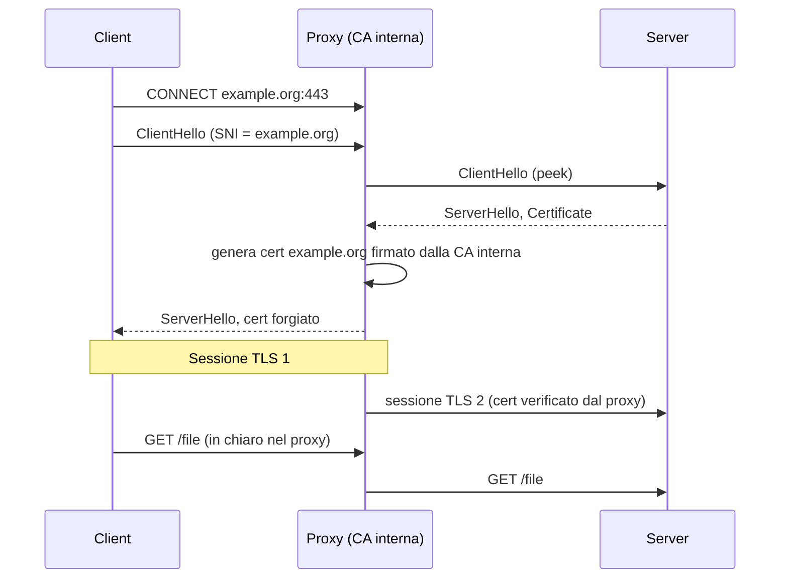

Un [IDS come Suricata]() o un [WAF]() leggono
il payload; ma con TLS 1.3 il payload è cifrato e anche il certificato del server non è più visibile. Il malware lo sa:
usa HTTPS per C2 ed esfiltrazione, convinto di essere invisibile. La **TLS inspection** (o SSL bump) è la contromisura
aziendale: un proxy si mette in mezzo, decifra, ispeziona e ricifra. È una vera attività di man-in-the-middle,
autorizzata, e come tale ha costi e rischi che vanno progettati.

## Perché conta

Senza inspection si può filtrare solo su IP, [SNI]() e metadati ([Zeek]()
li sfrutta bene). Con inspection si vedono URL, header, file scaricati (antivirus, sandbox) e richieste DLP. Ma il proxy
diventa un bersaglio di valore enorme: la sua CA, se rubata, permette di intercettare **tutta** l'azienda. Aggiungi
il costo prestazionale: due handshake e due cifrature per ogni connessione. Con handshake ECDHE (vedi
[TLS deep dive]()) il costo è dominato dalle operazioni su curva ellittica; la capacità
si stima come

$$N_{max} \approx \frac{C_{cpu}\cdot n_{core}}{t_{hs}+ B/\,r_{aead}}$$

dove $t_{hs}$ è il tempo di handshake per connessione, $B$ i byte trasferiti e $r_{aead}$ il throughput AEAD per core.

## Come funziona

Il client è configurato per fidarsi di una CA interna. Il proxy genera al volo un certificato per il sito richiesto,
firmato da quella CA, e apre una seconda sessione TLS verso il server vero.



Squid decide per connessione tra tre azioni: **peek** (legge il ClientHello/ServerHello senza decidere), **splice**
(tunnel opaco, nessuna decifrazione) e **bump** (intercetta). L'ordine corretto è peek al passo 1, poi splice o bump in
base a SNI e categoria.

## L'attacco

L'inspection ha anche un lato offensivo: è quello che fa `mitmproxy` in un pentest e che un malware con privilegi
locali fa installando una CA nel trust store. Su un host di test:

```bash
# CA di laboratorio e proxy trasparente
openssl req -x509 -newkey rsa:3072 -nodes -days 365 -subj "/CN=Lab Interception CA" \
  -keyout ca.key -out ca.crt
mitmproxy --mode regular --set confdir=./conf -p 8080
curl --proxy http://127.0.0.1:8080 --cacert ca.crt https://example.org/
```

Senza `--cacert` il client rifiuta: `curl: (60) SSL certificate problem: unable to get local issuer certificate`.
È la prova che la fiducia nasce dalla CA, non dal proxy. I punti deboli di una inspection mal fatta sono tre: (1) la CA
con chiave non protetta e senza vincoli, (2) il proxy che accetta certificati server non validi e li "ripulisce" con il
suo cert valido, (3) il pinning applicativo (app mobili, client Git) che si rompe e spinge a spegnere le verifiche.

## La difesa

La difesa è ridurre il raggio d'azione: CA dedicata con vincoli, chiave in HSM o almeno su file 0400, bump solo
dove serve, splice per categorie sensibili (banking, sanità, privacy) e verifica *rigorosa* del certificato reale.

```text {hl_lines=[3,4,10,11,14]}
http_port 3128 ssl-bump generate-host-certificates=on dynamic_cert_mem_cache_size=16MB \
    tls-cert=/etc/squid/ca/ca.crt tls-key=/etc/squid/ca/ca.key
tls_outgoing_options min-version=1.2
sslproxy_cert_error deny all

acl step1 at_step SslBump1
acl nobump_sni ssl::server_name .bank.example .salute.example .gov.example
acl nobump_cat dstdomain "/etc/squid/nobump.txt"

ssl_bump peek step1
ssl_bump splice nobump_sni
ssl_bump splice nobump_cat
ssl_bump stare all
ssl_bump bump all
```

Le righe evidenziate: `sslproxy_cert_error deny all` impedisce di nascondere errori del server reale (certificato
scaduto, hostname errato); `peek` poi `splice` permette di decidere sull'SNI senza decifrare; `bump all` intercetta
il resto. La CA va creata con `basicConstraints=CA:TRUE,pathlen:0` ed, se possibile, con `nameConstraints` (RFC 5280)
che la limitano ai domini di cui l'azienda risponde. Per i client rimangono:

- distribuzione della CA via GPO/MDM, mai installata a mano;
- policy interna e informativa ai dipendenti (obbligo legale in UE per il trattamento dei dati);
- log del proxy inviati al [SIEM]() con hash della richiesta, non il contenuto;
- ECH rende il peek sull'SNI inefficace: serve decidere su IP/categoria o disattivare ECH via DNS interno.

## Lab

Con un container Squid, un client Linux e un sito di test:

1. Genera la CA e configura Squid con `ssl_bump bump all`; installa `ca.crt` nel client e scarica un file con `curl`. Quale issuer vede `openssl s_client -connect example.org:443 -proxy 127.0.0.1:3128`?
2. Aggiungi `ssl_bump splice` per `.bank.example`: cosa cambia nell'issuer per quel dominio?
3. Servi dal sito di test un certificato scaduto con `bump all` e `sslproxy_cert_error` commentata: cosa vede il client? E con `deny all`?


<details><summary>Soluzione</summary>
<ol>
<li>L'issuer è <code>CN=Lab Interception CA</code>: il certificato visto dal client è forgiato dal proxy.</li>
<li>Con splice il proxy non decifra e l'issuer torna quello reale (per esempio Let's Encrypt): nessuna ispezione, ma anche nessuna rottura di pinning.</li>
<li>Con la direttiva commentata (o <code>allow all</code>) il proxy accetta il certificato scaduto e il client lo vede valido: è la vulnerabilità tipica. Con <code>deny all</code> il client riceve una pagina di errore generata da Squid.</li>
</ol>
</details>


## Conclusione

La TLS inspection restituisce visibilità, ma sposta la fiducia su una CA che va protetta come una chiave di dominio.
Regole pratiche: bump selettivo, splice sulle categorie sensibili, verifica severa dei certificati reali, CA vincolata
e monitorata. Dove possibile, preferisci [mTLS e identità dei workload]()
ai proxy intercettanti: meno magia, più fiducia esplicita.

**Prossimo nella serie:** [Torna alla roadmap]()
