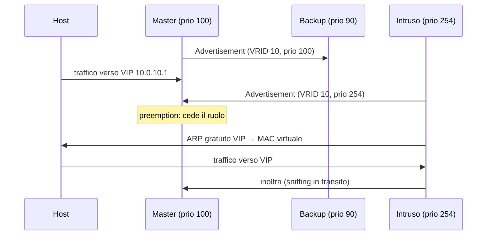

## Perché conta

Un host ha un solo default gateway. Se quel router si guasta, l'intera VLAN perde l'uscita. I protocolli di
**first hop redundancy** risolvono il problema facendo condividere a due o più router un indirizzo IP
virtuale: VRRP (RFC 5798) è lo standard aperto, HSRP (RFC 2281) è l'equivalente Cisco. Gli host puntano
all'IP virtuale e non si accorgono di quale router lo serva davvero.

Il rovescio è che l'elezione del router attivo si basa su messaggi multicast scambiati sul segmento, e
VRRPv3 non prevede alcuna autenticazione dei pacchetti (l'autenticazione presente in VRRPv2 fu rimossa
perché considerata inefficace contro un attaccante già presente sul link). Chiunque sia sulla VLAN può
quindi annunciarsi come router con priorità più alta e diventare il gateway di tutti gli host. È un
attacco di *man-in-the-middle* al livello più comodo possibile, della stessa famiglia di
[ARP spoofing]() e
[Spanning Tree]().

## Come funziona

Ogni gruppo ha un **VRID** (1-255) e una **priority** (1-254; 255 è riservata a chi possiede
davvero l'IP virtuale). Il master invia advertisement a `224.0.0.18` (protocollo IP 112, TTL 255) ogni
$T_{adv}$ secondi. I backup restano in ascolto e se non sentono nulla per

$$T_{down} = 3 \cdot T_{adv} + T_{skew}, \qquad T_{skew} = \frac{(256 - \text{priority}) \cdot T_{adv}}{256}$$

si dichiarano master. Con $T_{adv} = 1\,\text{s}$ il failover richiede circa 3-4 secondi. Se la
*preemption* è attiva (default), un router con priorità più alta che compare sul segmento si riprende
subito il ruolo di master: questa stessa regola, pensata per il failback dopo una manutenzione, è la
leva che un attaccante sfrutta.



## Il meccanismo del dirottamento

Il protocollo non nasconde nulla: VRID e indirizzo virtuale viaggiano in chiaro in ogni advertisement,
quindi un semplice `tcpdump -i eth0 proto 112` sul segmento rivela tutto ciò che serve per costruire un
pacchetto concorrente. L'unico campo che conta per vincere l'elezione è la **priority**: un
advertisement con VRID identico e priority 254 (il massimo utilizzabile, riservato a un router che non
possiede davvero l'IP) convince gli altri membri del gruppo a tornare in stato backup, per effetto della
preemption vista sopra.

Da lì in avanti l'esito dipende da cosa fa chi ha preso il ruolo di master:

- **Intercettazione:** assegna a sé l'IP virtuale e il MAC convenzionale del gruppo
  (`00:00:5e:00:01:<VRID>` per VRRP IPv4), annuncia l'associazione con un ARP gratuito e abilita
  l'inoltro IP verso il router legittimo. Gli host non notano interruzioni, ma ogni pacchetto passa
  prima da lì.
- **Denial of service puro:** basta annunciarsi master senza inoltrare nulla. L'intera VLAN perde il
  gateway finché gli advertisement fraudolenti non cessano.

Su HSRP l'attacco è concettualmente identico (UDP 1985 verso `224.0.0.2`); nella versione 1 l'unica
protezione aggiuntiva è una password trasmessa in chiaro nel pacchetto, leggibile con Wireshark con lo
stesso sforzo di cattura.

## La difesa

La prima regola è la stessa del [control plane](): VRRP
deve arrivare solo da chi ci si aspetta su quel link. I pacchetti legittimi hanno sempre TTL 255 — il
GTSM di RFC 5082 applicato implicitamente — quindi un pacchetto con TTL inferiore non ha mai attraversato
un solo hop ed è già un indicatore d'allarme, anche se non impedisce un intruso già presente sulla VLAN.
Per quello serve restringere *chi* può generare traffico verso il protocollo 112/UDP 1985 con nftables,
accettandolo solo dalle interfacce verso i router del gruppo:

```nft {hl_lines=[4,5]}
table inet vrrp_guard {
    chain forward {
        type filter hook forward priority 0;
        ip protocol vrrp iifname != { "eth-r1", "eth-r2" } drop
        ip daddr 224.0.0.18 iifname != { "eth-r1", "eth-r2" } drop
    }
}
```

Le due righe evidenziate scartano qualunque pacchetto VRRP (protocollo 112) o diretto al gruppo
multicast `224.0.0.18` che non arrivi dalle sole porte verso cui ci si aspetta un router del gruppo:
una porta d'accesso verso un host normale non dovrebbe mai generare o ricevere questo traffico, esattamente
come una porta d'accesso non dovrebbe mai parlare STP ([BPDU Guard]()).
Con `keepalived`, l'implementazione VRRP più comune su Linux, conviene inoltre:

```conf {hl_lines=[3]}
vrrp_instance VI_10 {
    state MASTER
    unicast_peer { 10.0.10.2 }   # niente multicast: solo i peer noti si parlano
    interface eth0
    virtual_router_id 10
    priority 100
    virtual_ipaddress { 10.0.10.1/24 }
}
```

Impostare `unicast_peer` (RFC 9568) elimina il multicast sul segmento: gli advertisement diventano
pacchetti unicast tra gli IP reali dei router del gruppo, già filtrabili per sorgente con una semplice
ACL, e un host qualunque sulla VLAN non li vede nemmeno passare.

## Lab

Con tre nodi Linux sulla stessa rete (containerlab o namespace di rete vanno bene), due con
`keepalived` configurato come gruppo VRRP attivo/passivo e un terzo come "intruso":

1. Porta su il gruppo VRRP tra i primi due nodi e osserva con `ip addr show eth0` su quale dei due
   compare l'IP virtuale. Interrompi il processo `keepalived` sul master e verifica il tempo di
   failover rispetto a $T_{down}$ calcolato sopra.
2. Applica la regola nftables mostrata in difesa sulla porta del terzo nodo e verifica con
   `tcpdump -i eth0 proto 112` che i suoi pacchetti verso `224.0.0.18` non escano più dall'interfaccia.
3. Passa `keepalived` a `unicast_peer` su entrambi i router del gruppo: cosa succede ora se il terzo
   nodo genera traffico multicast verso `224.0.0.18`, e perché non è più lo stesso attacco di prima?


<details><summary>Soluzione</summary>
<ol>
<li>L'IP virtuale compare sull'interfaccia del nodo con priority più alta (il master). Dopo aver fermato
<code>keepalived</code> sul master, il backup lo rileva e assume l'IP entro circa <code>T_down</code>
secondi, coerente con la formula: con <code>advert_int 1</code> e priority del backup pari a 90, il
failover osservato è vicino a 3,4 secondi.</li>
<li>Con la regola applicata, i pacchetti protocollo 112 generati dal terzo nodo verso
<code>224.0.0.18</code> vengono scartati dal filtro <code>forward</code> prima di raggiungere le altre
interfacce: <code>tcpdump</code> sulle porte dei router non mostra più traffico VRRP proveniente da
quella porta.</li>
<li>In modalità <code>unicast_peer</code> i router del gruppo non ascoltano più il gruppo multicast
<code>224.0.0.18</code>: si scambiano advertisement solo con gli IP peer configurati esplicitamente.
Il traffico multicast del terzo nodo non ha più nessun destinatario che lo elabori, perché nessun
router è in ascolto su quell'indirizzo: l'attacco perde il suo canale, non solo il filtro che lo blocca.</li>
</ol>
</details>


## Conclusione

VRRP e HSRP risolvono un problema reale di disponibilità fidandosi implicitamente di chiunque sappia
generare il pacchetto giusto sul segmento, esattamente come STP si fida di chiunque sappia parlare BPDU.
La difesa non è disabilitare la ridondanza, ma restringere chi può partecipare all'elezione: GTSM e
filtri per interfaccia come primo strato, `unicast_peer` per togliere del tutto il canale multicast dove
possibile, e un allarme su ogni cambio di master inatteso da inviare al
[SIEM]().

**Prossimo nella serie:** [Torna alla roadmap]()
