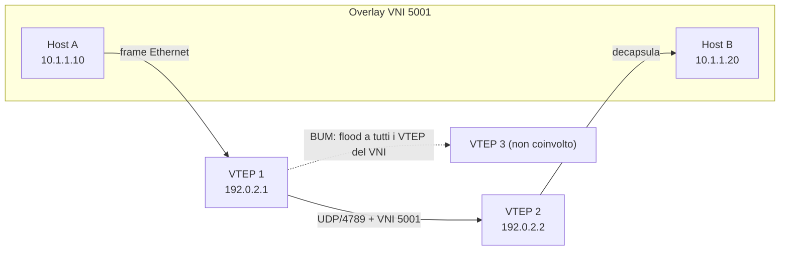

## Perché conta

VXLAN ([RFC 7348](https://www.rfc-editor.org/rfc/rfc7348)) nasce per un problema di scala: le VLAN classiche
hanno un identificatore a 12 bit, 4094 segmenti utilizzabili, troppo pochi per un data center multi-tenant.
VXLAN incapsula un frame Ethernet intero in UDP/4789 e lo porta su una rete IP qualunque, usando un
**VNI** (VXLAN Network Identifier) a 24 bit — oltre 16 milioni di segmenti logici indipendenti dalla
topologia fisica.

Il problema è che VXLAN è **un formato di incapsulamento**, non un protocollo di sicurezza: non prevede
autenticazione tra i VTEP (*VXLAN Tunnel Endpoints*, i nodi che incapsulano/decapsulano), non cifra nulla,
e nella sua forma più semplice replica sull'overlay lo stesso comportamento "fidati di chiunque parli il
protocollo" già visto in [ARP spoofing]() e
[STP]() — solo che qui il segmento di layer 2 può attraversare
l'intero data center, non più solo un singolo switch.

## Come funziona

Un VTEP incapsula ogni frame Ethernet in: header Ethernet esterno → IP esterno → UDP (porta destinazione
4789) → header VXLAN (8 byte, contiene il VNI) → frame Ethernet originale. Il MTU dell'underlay deve
assorbire l'overhead, tipicamente 50 byte in più.



Nel modello originale **flood-and-learn**, un frame broadcast/unknown-unicast/multicast (BUM) viene
replicato verso *tutti* i VTEP che condividono il VNI (via multicast IP o head-end replication unicast), e
ogni VTEP apprende quale MAC remota sta dietro quale IP sorgente del tunnel semplicemente osservando il
traffico ricevuto — esattamente come un bridge apprende le MAC da un frame qualsiasi, senza verificarne
l'origine. Se $k$ è il numero di VTEP nel VNI, il costo di un singolo frame BUM cresce come $O(k)$ per il
VTEP sorgente; su un VNI molto popolato questo è già di per sé un vettore di amplificazione.

## L'attacco

Nessuna delle informazioni nell'header VXLAN è autenticata: VNI, IP sorgente del VTEP, MAC interna sono
tutti campi che un host con accesso all'underlay può scrivere a piacere. Con `scapy` è immediato costruire
un pacchetto che si finge generato da un VTEP legittimo:

```python
from scapy.all import IP, UDP, Ether, VXLAN, sendp

# frame Ethernet "interno" falsificato: IP della vittima, MAC dell'attaccante
inner = Ether(src="02:00:00:00:00:99", dst="ff:ff:ff:ff:ff:ff") / \
        IP(src="10.1.1.10", dst="10.1.1.255")

pkt = Ether(dst="ff:ff:ff:ff:ff:ff") / \
      IP(src="192.0.2.99", dst="192.0.2.2") / \
      UDP(sport=52345, dport=4789) / \
      VXLAN(vni=5001) / inner

sendp(pkt, iface="eth0", count=50)
```

Tre effetti concreti, nessuno dei quali richiede compromettere un VTEP reale:

- **VTEP spoofing / MAC poisoning:** il VTEP ricevente apprende "la MAC `02:00:00:00:00:99` sta dietro
  `192.0.2.99`" per il VNI 5001, perché la fonte dell'apprendimento è il traffico stesso. Il traffico
  successivo verso quella MAC viene incapsulato verso l'attaccante — lo stesso principio dell'ARP
  poisoning, ma a cavallo di un tunnel IP.
- **Accesso a un VNI non autorizzato:** se l'attaccante conosce (o indovina) un VNI a 24 bit in uso, e
  l'underlay non filtra chi può inviare su UDP/4789, può iniettare o leggere traffico di un tenant che non
  gli appartiene — senza che esista alcuna credenziale da rubare: basta sapere il numero.
- **Amplificazione via flood:** inondando un VNI con frame BUM falsificati si sfrutta la replica $O(k)$
  per generare traffico verso ogni VTEP partecipante con uno sforzo di invio molto più piccolo, in modo
  simile a un'[amplificazione NTP/DNS]() ma dentro il data center.

## La difesa

La prima difesa non è un parametro di VXLAN, ma la rete sottostante: **nessun host che non sia un VTEP
autorizzato deve poter raggiungere la porta UDP/4789** di un altro VTEP. Su un nodo Linux che fa anche da
VTEP, con `nftables`:

```nftables {hl_lines=[4,5]}
table inet vxlan_guard {
    chain input {
        type filter hook input priority 0;
        ip saddr != { 192.0.2.1, 192.0.2.2, 192.0.2.3 } udp dport 4789 drop
        udp dport 4789 limit rate 20000/second burst 2000 packets accept
        udp dport 4789 drop
    }
}
```

La prima riga evidenziata limita UDP/4789 ai soli indirizzi IP dei VTEP noti — un allowlist statica, non
diversa nel principio da [BCP 38 / uRPF]() applicato a un
protocollo specifico. La seconda introduce un rate limit per contenere un flood BUM anche da un VTEP
legittimo ma compromesso.

Il cambiamento strutturale è però sostituire il **flood-and-learn** con un control plane: **EVPN**
([RFC 7432](https://www.rfc-editor.org/rfc/rfc7432), applicato a VXLAN in
[RFC 8365](https://www.rfc-editor.org/rfc/rfc8365)) distribuisce le associazioni MAC/IP↔VTEP via **BGP**,
come route EVPN di tipo 2. Un VTEP non apprende più "chi sta dietro quale IP" osservando passivamente il
traffico: lo riceve come annuncio BGP, soggetto alle stesse protezioni già viste per il BGP stesso — sessioni
autenticate (es. TCP-AO, vedi [TCP RST injection]()),
filtri sui prefissi annunciabili, e un operatore che sa esattamente quali route accettare da quale peer.
Il traffico BUM residuo (soprattutto broadcast ARP) si riduce drasticamente perché EVPN può rispondere
localmente alle richieste ARP/ND di cui conosce già la risposta (*ARP suppression*), invece di floodare
l'intero VNI.

Dove l'underlay stesso attraversa un segmento non fidato (un link WAN tra data center), VXLAN va inoltre
cifrato a livello di trasporto — IPsec sull'underlay o, su link diretti layer 2, [MACsec]() — perché l'incapsulamento VXLAN da solo non offre alcuna
confidenzialità.

## Lab

Con containerlab e due nodi Linux VTEP (`ip link add vxlan0 type vxlan id 5001 dstport 4789 ...`) collegati
da un terzo nodo "underlay" senza alcun filtro:

1. Configura `vxlan0` sui due VTEP in flood-and-learn (gruppo multicast o `remote` statico), porta un host
   di test su ciascun bridge e verifica con `bridge fdb show dev vxlan0` che le MAC remote vengano apprese
   dal traffico.
2. Dal nodo underlay, non VTEP, invia un frame VXLAN falsificato come nell'esempio `scapy` sopra, con una
   MAC e un IP interno diversi da quelli reali. Osserva cosa succede alla tabella FDB del VTEP ricevente.
3. Applica la regola `nftables` con l'allowlist sugli indirizzi VTEP e ripeti il punto 2: cosa cambia?


<details><summary>Soluzione</summary>
<ol>
<li>Dopo un primo scambio di traffico, <code>bridge fdb show dev vxlan0</code> mostra le MAC remote
associate all'IP del VTEP da cui è arrivato il frame che le conteneva: l'apprendimento è passivo, nessuna
verifica sulla fonte.</li>
<li>Il VTEP ricevente apprende la voce falsificata esattamente come una legittima: la FDB ora associa la
MAC fabbricata al VTEP reale che per primo ha inviato quel VNI, e il traffico successivo verso quella MAC
viene incapsulato verso l'IP reale del mittente del frame contraffatto (che può non essere il VTEP
previsto, se l'IP esterno del pacchetto scapy è stato a sua volta falsificato).</li>
<li>Con l'allowlist attiva, il frame proveniente dal nodo underlay (che non è nella lista degli indirizzi
VTEP ammessi) viene scartato prima di raggiungere la porta 4789: la FDB non viene mai alterata. La difesa
agisce a livello di underlay, non dentro VXLAN.</li>
</ol>
</details>


## Conclusione

VXLAN risolve un problema di scala della rete, non un problema di sicurezza: incapsula, non autentica.
Trattarlo come un protocollo "di overlay quindi isolato" è un errore — l'isolamento tra VNI vale solo se
l'underlay impedisce a chiunque non sia un VTEP autorizzato di scrivere su UDP/4789, e il flood-and-learn
va sostituito con un control plane verificabile come EVPN ovunque la scala o la fiducia tra i nodi lo
richiedano.

**Prossimo nella serie:** [Torna alla roadmap]()
