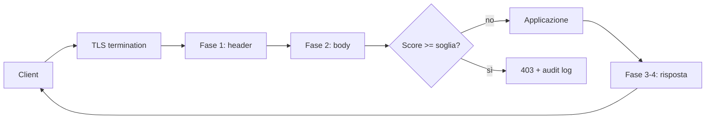

## Perché conta

Un [firewall stateful]() decide su IP, porta e stato della
connessione. Una `GET /search?q=' OR 1=1--` verso la porta 443 è, per lui, identica a una ricerca innocente: stesso flusso
TCP, stessa porta consentita. Anche un [IDS/IPS]() vede il traffico solo se riesce a decifrarlo.

Il **Web Application Firewall (WAF)** lavora a livello 7, **dopo** la terminazione TLS: ispeziona metodo, URI, header e body
e applica regole sul contenuto. Non sostituisce il codice sicuro (la SQL injection si risolve con le query parametrizzate),
ma è un cuscinetto utile: *virtual patching* di una vulnerabilità nota mentre aspetti il fix, blocco del rumore automatico, logging uniforme.

## Come funziona

Il WAF sta davanti all'applicazione come reverse proxy o modulo del web server (ModSecurity, Coraza). Le regole sono scritte
in **SecLang** e valutate in fasi: header della richiesta, body, header della risposta, body della risposta, logging.



Il **Core Rule Set (CRS)** non blocca alla prima regola che scatta: usa l'**anomaly scoring**. Ogni regola somma punti
(critical = 5, error = 4, warning = 3, notice = 2) e solo a fine fase si confronta il totale con la soglia:

$$S = \sum_{i=1}^{n} w_i \cdot m_i \qquad \text{blocco se } S \ge T$$

dove $m_i \in \{0,1\}$ indica se la regola $i$ è scattata e $w_i$ è il suo peso. Con $T=5$ basta una regola critical;
alzare $T$ riduce i falsi positivi ma lascia passare attacchi che accumulano pochi punti. Il **paranoia level** (1–4)
decide invece *quante* regole sono attive: il livello 1 è il compromesso per produzione, i successivi sono più severi.

## L'attacco

Un WAF a firme si aggira cambiando la forma senza cambiare la semantica per il database. Prima la richiesta di base, bloccata:

```bash
curl -s -o /dev/null -w "%{http_code}\n" \
  "https://shop.example.org/search?q=1'%20UNION%20SELECT%20username,password%20FROM%20users--"
# 403
```

Poi varianti classiche: commenti inline al posto degli spazi, maiuscole alternate, double URL encoding, parametri duplicati
(HTTP Parameter Pollution), body in un formato che il WAF non decodifica come il backend.

```bash
# commenti MySQL al posto degli spazi + case mixing
curl -s "https://shop.example.org/search?q=1'/**/UnIoN/**/SeLeCt/**/username,password/**/FROM/**/users--"

# double encoding: il WAF decodifica una volta, l'applicazione due
curl -s "https://shop.example.org/search?q=1%2527%2520OR%25201%253D1--"
```

La lezione è la stessa del [DNS tunneling](): se il difensore interpreta il
traffico in modo diverso dal destinatario, c'è una zona d'ombra. Un attaccante serio non prova payload a caso:
fa fingerprinting del WAF e cerca le divergenze di parsing. E il WAF non copre ciò che non è HTTP leggibile: logica di business,
`IDOR`, credenziali rubate.

## La difesa

Esempio con ModSecurity v3 (o Coraza) su nginx: engine attivo, CRS incluso, soglie esplicite.

```apache {hl_lines=[2,3,9,10,11]}
# modsecurity.conf
SecRuleEngine On
SecRequestBodyAccess On
SecAuditEngine RelevantOnly
SecAuditLog /var/log/modsec_audit.json
SecAuditLogFormat JSON

# crs-setup.conf
SecAction "id:900110,phase:1,pass,nolog,\
  setvar:tx.inbound_anomaly_score_threshold=5,\
  setvar:tx.blocking_paranoia_level=1"
Include /etc/crs/rules/*.conf
```

Il rollout corretto è graduale: parti con `SecRuleEngine DetectionOnly`, leggi l'audit log per una o due settimane,
scrivi le **esclusioni** per i falsi positivi (un editor WYSIWYG che invia HTML legittimo scatterà), poi passa a `On`.

```apache
# esclusione mirata: il campo "body" dell'editor non va controllato dalla regola XSS 941100
SecRule REQUEST_URI "@beginsWith /admin/post" \
  "id:1001,phase:1,pass,nolog,\
  ctl:ruleRemoveTargetById=941100;ARGS:body"
```

Altre misure che rendono il WAF più utile: **rate limiting** per IP e per endpoint (login, ricerca), regole *positive* (allow-list di metodi e content-type
per le API) accanto alle firme, e invio dell'audit log al [SIEM]() per correlare
blocchi ripetuti dallo stesso IP con altri segnali. Il WAF non vede il traffico est-ovest: per quello servono
[microsegmentazione]() e [mTLS]().

## Lab

Con Docker: un container nginx+ModSecurity con CRS davanti a un'app vulnerabile (ad esempio DVWA).

1. Avvia con `SecRuleEngine DetectionOnly` e lancia `' OR 1=1--` su un parametro. Che cosa vedi nell'audit log?
2. Passa a `On` e ripeti: quale codice HTTP ricevi? Quale score viene riportato?
3. Prova la variante con commenti inline (`/**/`) e il double encoding. Il CRS al paranoia level 1 le ferma?
4. Alza `blocking_paranoia_level` a 2 e naviga l'applicazione normalmente: compaiono falsi positivi?


<details><summary>Soluzione</summary>
<ol>
<li>In <code>DetectionOnly</code> la richiesta passa (200) ma l'audit log contiene le regole scattate (famiglia 942xxx per SQLi) e lo score totale: è la fase di tuning.</li>
<li>Con <code>On</code> ricevi <code>403</code>; il log riporta lo <em>inbound anomaly score</em> maggiore o uguale a 5, somma dei punti delle regole 942xxx scattate.</li>
<li>Il CRS normalizza (<code>t:urlDecodeUni</code>, <code>t:removeComments</code>, <code>t:lowercase</code>) e di solito ferma i commenti inline e il case mixing. Il double encoding dipende da quante volte il WAF decodifica rispetto all'applicazione: se il backend decodifica due volte e il WAF una, il payload può passare. È la divergenza di parsing descritta sopra.</li>
<li>Sì, tipicamente su form con testo libero o JSON: ogni falso positivo si risolve con un'esclusione mirata (<code>ruleRemoveTargetById</code>), non disattivando la regola ovunque.</li>
</ol>
</details>


## Conclusione

Un WAF aggiunge visibilità e tempo, non sicurezza strutturale: abbassa il rumore, permette il virtual patching e produce log
utili, ma un attaccante motivato cerca la divergenza tra come il WAF e l'applicazione interpretano la richiesta. Tienilo in
`DetectionOnly` finché non conosci i tuoi falsi positivi, misura lo score, accompagnalo a query parametrizzate, rate limiting e
monitoraggio. Considera l'allow-list per le API: è più robusta di qualsiasi lista di firme.

**Per approfondire:** [Stateful firewall con nftables]() · [Torna alla roadmap]()
