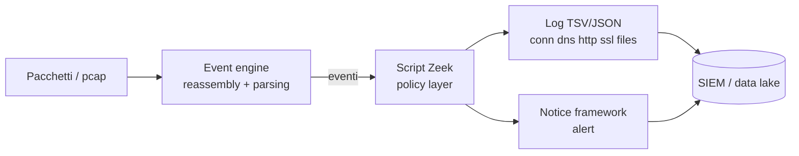

## Perché conta

Con [Suricata]() rispondi alla domanda "questo pacchetto
corrisponde a una firma nota?". È una domanda utile ma limitata: un C2 con un dominio nuovo, TLS valido e
traffico a basso volume non ha firme. Quello che lo tradisce è il **comportamento**: connessioni a intervalli
regolari, un client che parla con un solo host ogni 60 secondi per giorni, un certificato self-signed su
una porta insolita.

**Zeek** (ex Bro) nasce per questo: non è un motore di firme ma un *analizzatore di traffico* che trasforma i
pacchetti in log strutturati ed eventi programmabili. È la base del **Network Security Monitoring (NSM)**:
raccogliere sempre i metadati di rete, così quando arriva un indicatore (un IP, un hash, un dominio) puoi
ricostruire retroattivamente chi ha parlato con chi. Zeek è complementare al
[SIEM](): produce il log di rete che il SIEM correla con quelli degli host.

## Come funziona

Zeek legge da un'interfaccia (o da un pcap), ricostruisce i flussi e fa il parsing dei protocolli in
un **event engine**. Ogni cosa riconosciuta genera un evento (`connection_state_remove`, `dns_request`,
`ssl_established`); gli script nel *policy layer* reagiscono agli eventi e scrivono nel **Logging framework**
o sollevano un `Notice`.



Ogni connessione ha un **uid** che la lega a tutti gli altri log: da una riga di `conn.log` salti al
`dns.log` che ha risolto il nome e al `ssl.log` con il certificato. È questo, più dei singoli campi,
che rende Zeek uno strumento di investigazione.

| Log | Contenuto | Perché serve |
|---|---|---|
| `conn.log` | Ogni flusso L3/L4: IP, porte, durata, byte, `conn_state` | Baseline, beaconing, exfiltration |
| `dns.log` | Query, risposte, rcode | DGA, [DNS tunneling]() |
| `ssl.log` | SNI, versione TLS, cert chain | Cert anomali, [ECH]() |
| `http.log` | Metodo, host, URI, user-agent | Downloader, user-agent sospetti |
| `files.log` | Hash (MD5/SHA1) dei file in transito | Malware noto, IOC retroattivi |

## L'attacco

Un impianto C2 tipico fa **beaconing**: a intervalli fissi interroga il server per ricevere comandi. Per
non essere banale aggiunge *jitter*, cioè un ritardo casuale. Simuliamo un beacon da 60 s con jitter del 10%:

```bash
# simula un beacon HTTPS verso un host del lab, ogni 60s ±10%
while true; do
  curl -sk https://c2.lab.example/ping -o /dev/null
  sleep $(awk 'BEGIN{srand(); print 60 + (rand()-0.5)*12}')
done
```

Un analista umano non lo nota nel mare di traffico; un conteggio di byte nemmeno (sono pochi). Ma gli
intervalli sono troppo regolari per essere traffico umano. Misuriamo la regolarità con il
**coefficiente di variazione** degli intervalli $\Delta t_i$ tra connessioni successive della stessa coppia
origine-destinazione:

$$
CV = \frac{\sigma(\Delta t)}{\mu(\Delta t)}
$$

Per navigazione umana $CV$ è alto (> 1: raffiche e pause); per un beacon con jitter del 10% è circa
$0{,}06$. Una soglia come $CV < 0{,}2$ con almeno 20 campioni isola i candidati con pochi falsi positivi
(restano timer legittimi: NTP, update checker, monitoring, da mettere in allowlist).

## La difesa

Prima il deployment: Zeek in modalità JSON, sulla porta mirror dello switch (vedi
[packet analysis]()) o su un TAP.

```bash
zeekctl deploy                                   # avvia il cluster standalone
zeek -C -r sospetto.pcap LogAscii::use_json=T    # analisi offline di un pcap
zeek-cut -d ts id.orig_h id.resp_h id.resp_p < conn.log | head
```

Poi lo script. Per ogni coppia orig/resp teniamo gli ultimi timestamp e, a ogni nuova connessione, calcoliamo
$CV$ degli intervalli:

```zeek {hl_lines=[3,12,19,24]}
@load base/frameworks/notice

module Beacon;

export {
    redef enum Notice::Type += { Beacon::Suspect };
    const min_samples = 20 &redef;
    const max_cv = 0.2 &redef;
}

global last_seen: table[addr, addr] of time &create_expire=6hrs;
global gaps: table[addr, addr] of vector of double &create_expire=6hrs;

event connection_state_remove(c: connection)
    {
    local o = c$id$orig_h;
    local r = c$id$resp_h;
    local now = c$start_time;

    if ( [o, r] in last_seen )
        {
        if ( [o, r] !in gaps ) gaps[o, r] = vector();
        gaps[o, r] += time_to_double(now) - time_to_double(last_seen[o, r]);

        if ( |gaps[o, r]| >= min_samples )
            {
            local mu = 0.0; local var = 0.0;
            for ( i in gaps[o, r] ) mu += gaps[o, r][i];
            mu /= |gaps[o, r]|;
            for ( i in gaps[o, r] ) var += (gaps[o, r][i] - mu) * (gaps[o, r][i] - mu);
            var /= |gaps[o, r]|;
            if ( mu > 0.0 && sqrt(var) / mu < max_cv )
                {
                NOTICE([$note=Beacon::Suspect, $conn=c,
                        $msg=fmt("Intervalli regolari %s -> %s (media %.1fs)", o, r, mu),
                        $identifier=cat(o, r), $suppress_for=6hrs]);
                delete gaps[o, r];
                }
            }
        }
    last_seen[o, r] = now;
    }
```

Le righe evidenziate sono quelle che contano: la tabella con `&create_expire` (la memoria è limitata, senza
scadenza lo stato crescerebbe all'infinito), il calcolo di $CV$, la `NOTICE` e la soppressione degli alert
duplicati con `$suppress_for`. Caricalo da `local.zeek` con `@load ./beacon` e inoltra `notice.log` al
SIEM. Zeek ha già pacchetti maturi per questo (vedi `zkg` nel link sopra): in produzione conviene partire da lì
e usare lo script come base didattica.

Tre accorgimenti operativi:

- **Dimensiona l'hardware sul traffico**: oltre ~1 Gbit/s serve un cluster con più worker e il load
  balancing per flusso (AF_PACKET).
- **Cifratura**: il payload TLS è opaco, ma `conn.log`, `ssl.log` e le tempistiche restano visibili; per questo
  il beaconing si vede anche su HTTPS.
- **Retention**: i metadati costano poco. Tenere 90 giorni di `conn.log` vale più di 3 giorni di pcap completi.

## Lab

Scarica un pcap di traffico con beacon (o genera il tuo con lo script `curl` sopra, catturando con
`tcpdump -i br0 -w beacon.pcap`) e rispondi:

1. Quale comando estrae da `conn.log` le coppie con più di 20 connessioni verso lo stesso host?
2. Perché un jitter del 50% rende più difficile rilevare il beacon con una soglia fissa su $CV$?
3. Come distingui un beacon da un update checker legittimo?


<details><summary>Soluzione</summary>

<p><strong>1.</strong> Aggregazione con <code>zeek-cut</code> e <code>sort</code>:</p>
<pre><code>zeek-cut id.orig_h id.resp_h &lt; conn.log | sort | uniq -c | sort -rn | awk '$1 &gt; 20'</code></pre>

<p><strong>2.</strong> Con jitter uniforme del ±50% gli intervalli variano tra 0,5μ e 1,5μ, quindi
<code>CV</code> ≈ 0,29: supera la soglia di 0,2. Si risolve alzando la soglia (più falsi positivi) o
usando metriche più robuste, come la mediana e la deviazione assoluta mediana, o un test sul
periodo dominante (autocorrelazione).</p>

<p><strong>3.</strong> Dal contesto: destinazione (reputation, età del dominio, certificato in
<code>ssl.log</code>), user-agent in <code>http.log</code>, quantità di dati trasferiti e, soprattutto,
se un processo noto sull'host giustifica il traffico. Gli update checker legittimi vanno in allowlist.</p>

</details>


## Conclusione

Le firme dicono *cosa* è noto; i metadati dicono *cosa è successo*. Zeek ti dà una memoria di rete interrogabile:
quando un IOC emerge a distanza di settimane, puoi chiederti chi ha contattato quell'IP e quando. Il
beaconing con $CV$ è solo un esempio di detection comportamentale, ma mostra il metodo: scegliere un'invariante
che l'attaccante fatica a nascondere e misurarla. Abbinalo a [Suricata]()
per le firme e al [SIEM]() per la correlazione.

**Prossimo nella serie:** [Port knocking e SPA]() · [Torna alla roadmap]()
